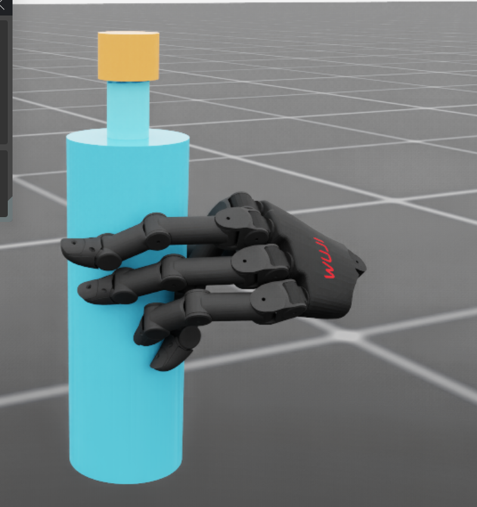

# Phase 0F: left cylindrical bottle grasp

The requested target is the **70 mm engineering bottle body**. The four long
fingers should wrap one side of the middle/upper sidewall and the thumb should
oppose them. `left.png` is a qualitative pose reference, not dimensioned CAD.
The bottle and cap are still free dynamic bodies, with gravity and normal
finger drives enabled.

## What changed

- [Geometry proposal](phase0f_left_cylindrical_power_proposal.json) stores an
  explicit left wrist pose and 20 independent joint targets, plus a collision
  checked open preshape. It uses official Beta 1 MJCF only for **offline
  geometry**. The formal physical asset remains official Beta 1 Isaac USD.
- [Geometry checker](../../scripts/environments/validate_left_power_geometry.py)
  checks finger sidewall height, thumb opposition and a 21 point closing path.
- `GraspSynthesisFixture(require_power_grasp=True)` now measures five distinct
  force bearing digit contacts on the bottle body at every release and Reset
  replay substep. A sample cannot pass because only the thumb and two long
  fingers hold the bottle. The old left grasp bank is left intact.
- `--ramp_fixed_support` releases the temporary world joint before settle,
  gradually removes a bounded support wrench, then measures a full second
  with no support. The candidate is captured after the ramp reaches zero.
- The [preview candidate](phase0f_left_power_pose_candidate.json) is
  deliberately `validated=false`. It is a real PhysX release state and can be
  inspected without entering a validated bank.



The image is a GUI snapshot of the candidate, not a physical acceptance
result. The thumb is partly hidden behind the bottle in this viewing angle.

## Measured result

The [offline geometry report](phase0f_left_power_geometry_report.json),
[PhysX summary](phase0f_left_power_diagnostic.json) and
[full PhysX trajectory](phase0f_left_power_physx_diagnostic.json.gz) record
proposal 9505. The official MJCF geometry check passed: start bottle clearance
4.07 mm, minimum cross finger clearance during closing 2.33 mm, long finger
half arc 30.7°, thumb opposition 145.2°. The five closest cylinder points are
within the specified middle/upper sidewall band. MJCF distances are proposal
data; the actual USD collision separation is measured by PhysX.

With temporary support fully removed and gravity on, the bottle moved
0.062 mm and rotated 0.116° in one second. The first release separation was
-0.004 mm and worst observed separation -0.070 mm. The largest formation
contact force was 56.9 N. No bottle/ground, right/cap or left/cap contact was
reported during that hold. Thus the **physical hold and visual geometry are
promising**, but the requested strict five digit force gate **failed**:
thumb, middle and ring were force bearing throughout; index was 0% and pinky
4.4% above the configured 0.05 N per point floor. The index remained around
0.05–0.07 mm from the bottle surface after release, but proximity is not
counted as gripping force. The candidate has **not** entered a validated bank.
Sampled PhysX sidewall contact points put the thumb at -145.5° and the four
long fingers at approximately 51.1°, 57.8°, 58.4° and 109.8° in the bottle
local XY plane. Their sampled axial heights were about 22–43 mm above the
bottle center, away from the neck and cap. These positions establish the
visual topology but do not establish five-finger load sharing.

An independent Reset replay of this release state held the bottle to 0.140 mm
displacement, but again failed the five digit force gate. Directed index
target and submillimeter wrist adjustments increased intermittent index
contact to at most 20.4% of the second; they did not create a stable five
digit force distribution. The [diagnostic JSON](phase0f_left_power_diagnostic.json)
contains each measured contact ratio and displacement. The old seed 204
state also fails the new topology because its pinky is far from the bottle.

This points to an **underloaded index and pinky after support removal**, not
deep initial penetration or inadequate gross holding force. The next focused
experiment is a contact feedback controlled closing trajectory that balances
index/pinky load while maintaining thumb and middle/ring opposition. The
result still needs a fresh, static target Reset replay before bank admission.

## Reproduce

Set `WUJI_DESCRIPTION_ROOT` to the official `v2026.9.11` checkout and
`ISAACLAB_PYTHON` to the Isaac Sim 6.0.1 / Isaac Lab 3.0 Python. Then run:

```bash
"$ISAACLAB_PYTHON" scripts/environments/validate_left_power_geometry.py \
  --proposal docs/assets/phase0f_left_cylindrical_power_proposal.json

./scripts/run_isaaclab.sh scripts/environments/generate_grasp_synthesis.py \
  --headless --reach_scan docs/assets/phase0f_left_cylindrical_power_proposal.json \
  --proposal_index 9505 --candidate_count 1 --control_mode pose_command_wrist \
  --fixed_support --ramp_fixed_support --start_at_goal --require_power_grasp \
  --close_s 1.2 --settle_s 0.8 --output /tmp/phase0f_left_power.json

./scripts/run_isaaclab.sh scripts/environments/preview_grasp_initialization.py \
  --candidate docs/assets/phase0f_left_power_pose_candidate.json \
  --interactive_static --viz kit \
  --camera_eye 0.25 0.50 0.68 --camera_target 0 0 0.53
```

The GUI shows the stored release pose without marking it validated. PhysX
results must be checked from the generated JSON; GUI appearance is not
acceptance evidence. Add `--contact_debug` to show contact markers.
