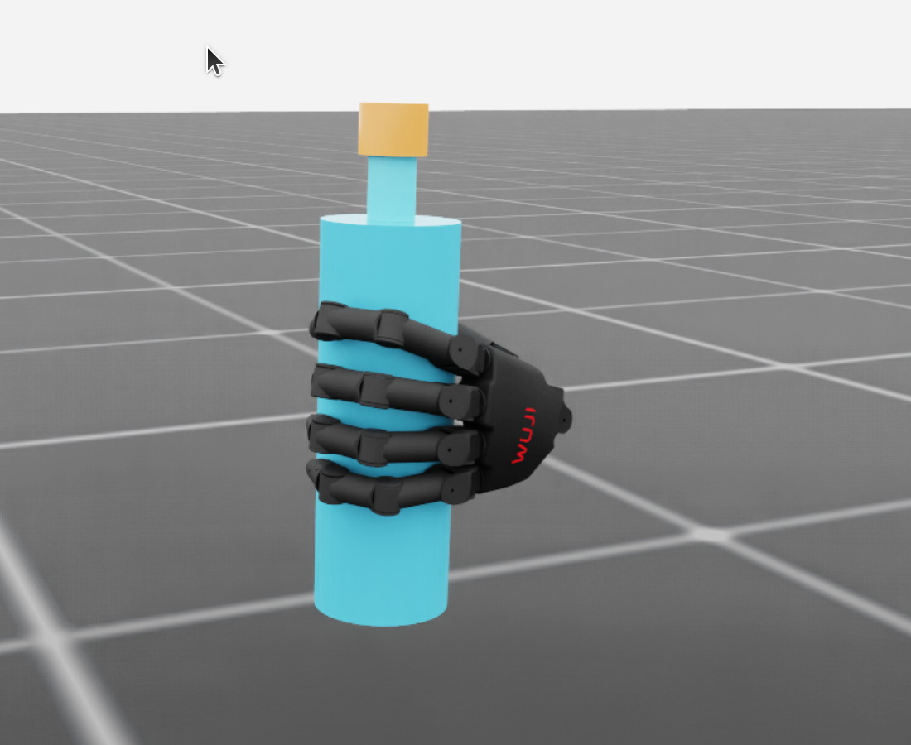

# Phase 0G: left hand bottle pose based on `left.png`

The previous Phase 0F proposal did not match the supplied image. Its palm
collision surface was about 24 mm from the 70 mm diameter bottle. The four
knuckles ran diagonally around the bottle, and the index fingertip extended
below the little finger instead of joining a vertical curled row.

This revision places the left palm about 2.95 mm from the bottle and rotates
the wrist so the index, middle, ring and little fingertips form a vertical row
on one side of the body. The thumb approaches the opposite side. The hand
contacts the middle and upper body, away from the cap and neck. The proposal
uses the official Beta 1 left model at `c2cd7f8d1ef8b6dc8cb907c17daa5a88b4442d95`;
it is still only a candidate for the user's unverified hardware variant.



The screenshot shows the physically formed, **unvalidated** release-start
state from candidate 9705. The right hand is hidden in the viewer only. The
bottle, cap, gravity, collision and finger joint drives remain active. From
this front view the bottle occludes the opposing thumb; orbit the GUI to see
it behind the body.

## Geometry and controlled closure

The wrist root for the first collision-qualified proposal is
`(-0.085, 0.015, 0.4925)` m with quaternion `xyzw =
(0.1432534, -0.7794203, 0.0917020, 0.6029703)`. The four official fingertip
sites lie at bottle-local axial heights approximately `+46.6, +21.2, -2.3,
-23.9` mm, in index-to-little-finger order. Their radial distances are
36.9–38.3 mm. The measured geometric thumb-versus-four-finger contact angle
is 154°, with the four finger contacts within a 3.4° half arc. These are
official MJCF *geometry* checks, not a PhysX grasp certificate.

Straight interpolation from a collision-free open hand drove the thumb
distal collision body about 4.6 mm into the bottle midway through closure.
The new staged drive sequence first changes thumb abduction and IP, then
curls the four long fingers, then closes the thumb CMC flexion. The official
MJCF sampled path for proposal 9701 has no more than 0.8 mm nominal
penetration. `interpolate_joint_waypoints` supplies continuous 20-joint
position targets; the hand and bottle are not moved by per-step pose writes.
The image-specific geometry check also rejects the earlier Phase 0F proposal
(palm gap 23.6 mm) and accepts proposal 9701.

The explicit joint targets and staging points are in the JSON proposal
files. `validate_left_power_geometry.py` checks official joint limits,
collision clearances, palm proximity, real fingertip-site ordering and
thumb opposition. Stronger drive preload proposals 9704–9705 exceed the
conservative 2 mm *commanded target* geometry limit. Their physically
realized penetration is measured separately below and stays below 0.1 mm.
These stronger targets must not be used as direct-reset joint positions.

## PhysX measurements

All rows used the official Isaac USD, fixed left wrist, 20 physical finger
drives, free bottle and cap, gravity on, and a 1 second unsupported release.
The initial support was either a temporary fixed joint or a bounded wrench;
no support was present during the hold. The `release_passed` result includes
the strict five-digit force topology rule and independent Reset replay.

| Candidate | Formation result | Unsupported bottle displacement | Peak monitored contact force | Five-digit topology ratio |
| --- | --- | ---: | ---: | ---: |
| 9701, fixed support | Aborted: 102.7 N at first little-finger contact | Not run | 102.7 N | Not run |
| 9701, bounded support | Bottle fell | 484.6 mm | 0.9 N | 0% |
| 9702, light preload | Held spatially; topology failed | 0.10 mm | 7.3 N | 0% |
| 9703, five-digit tuning | Held spatially; topology failed | 0.33 mm | 8.2 N | 0% |
| 9704, drive preload | Held spatially; topology failed | 1.28 mm | 16.1 N | 0% |
| 9705, sustained-contact tuning | Held spatially; topology failed | 1.35 mm | 21.0 N | 3.6% |

For 9705, the maximum measured physical penetration was 0.099 mm and bottle
rotation was 1.49°. Force-bearing sidewall contact ratios were thumb 100%,
index 99.8%, middle 65%, ring 83.2%, little finger 53.4%. Some index and ring
proximal contacts occur around 105–109° while the intended distal contacts
are near 20°. This makes the measured four-finger force spread exceed the
70° topology limit in some frames, even when all five digits touch. Contact
loads therefore still need redistribution toward the four distal finger
pads. The held bottle is **not** a validated cylindrical power grasp, and no
sample has been added to `grasp_init_bank` or claimed to pass Reset replay.

The smallest next physical experiment is to change the index/ring proximal
contact geometry relative to the bottle by a millimetre-scale wrist placement
adjustment and compensate distal curl with individual joints. Compare the
actual per-body contact angles and forces over the same unsupported 1 second
hold. Increasing search count or relaxing the five-digit gate would not
resolve this measured failure.

## Reproduction

```bash
export WUJI_DESCRIPTION_ROOT=/tmp/wuji-description-v2026.9.11
export ISAACLAB_PYTHON=/home/ubuntu/miniconda3/envs/allo_track/bin/python

$ISAACLAB_PYTHON scripts/environments/validate_left_power_geometry.py \
  --proposal docs/assets/phase0g_left_image_power_proposal.json

./scripts/run_isaaclab.sh scripts/environments/generate_grasp_synthesis.py \
  --headless --device cuda:0 \
  --reach_scan docs/assets/phase0g_left_image_power_sustained_proposal.json \
  --candidate_count 1 --control_mode fixed_wrist --start_at_goal \
  --require_power_grasp --close_s 1.2 --settle_s 0.3 \
  --output /tmp/phase0g-repeat.json

./scripts/run_isaaclab.sh scripts/environments/preview_grasp_initialization.py \
  --viz kit --device cuda:0 \
  --synthesis_report docs/assets/phase0g_left_image_power_sustained_physx.json \
  --focus_left --interactive_static \
  --camera_eye 0.28 0.62 0.66 --camera_target 0 0 0.51
```

The `phase0g_left_image_power_*_physx.json` files preserve actual trajectories,
joint states, contact point/normal/force data and the rejected release result.
The preview command is for visual inspection; it does not mark the sample
validated.
