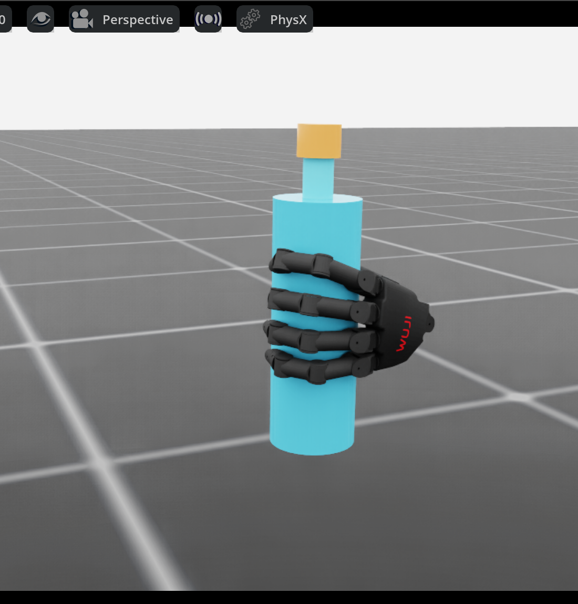
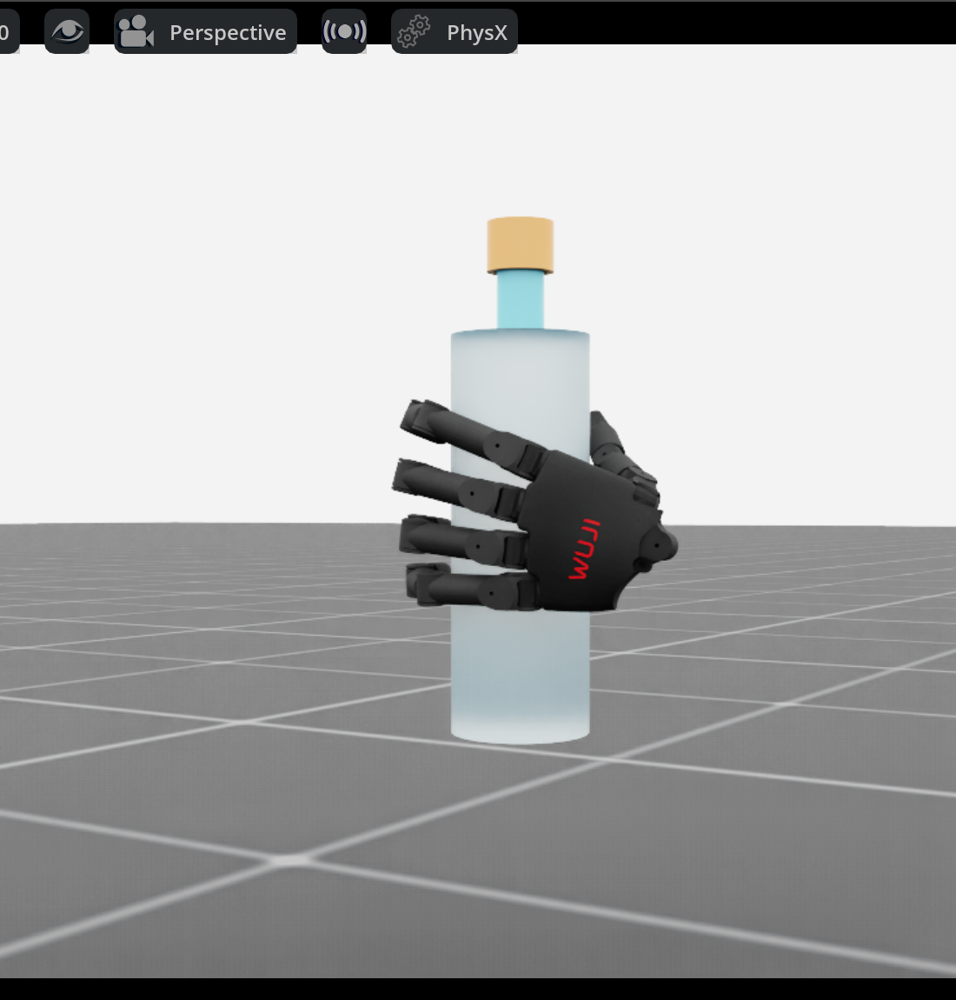

# Phase 0G: left hand bottle pose based on `left.png`

The previous Phase 0F proposal did not match the supplied image. Its palm
collision surface was about 24 mm from the 70 mm diameter bottle. The four
knuckles ran diagonally around the bottle, and the index fingertip extended
below the little finger instead of joining a vertical curled row.

This revision places the left palm about 2.95 mm from the bottle and rotates
the wrist so the index, middle, ring and little fingertips form a vertical row
on one side of the body. The thumb approaches the opposite side. The hand
contacts the middle and upper body, away from the cap and neck. The proposal
uses the official Beta 1 left model at `c2cd7f8d1ef8b6dc8cb907c17daa5a88b4442d95`;
it is still only a candidate for the user's unverified hardware variant.


The screenshot shows the physically formed, **unvalidated** release-start
state from candidate 9705. The right hand is hidden in the viewer only. The
bottle, cap, gravity, collision and finger joint drives remain active. From
this front view the bottle occludes the opposing thumb; orbit the GUI to see
it behind the body.

## Geometry and controlled closure

The wrist root for the first collision-qualified proposal is
`(-0.085, 0.015, 0.4925)` m with quaternion `xyzw =
(0.1432534, -0.7794203, 0.0917020, 0.6029703)`. The four official fingertip
sites lie at bottle-local axial heights approximately `+46.6, +21.2, -2.3,
-23.9` mm, in index-to-little-finger order. Their radial distances are
36.9–38.3 mm. The measured geometric thumb-versus-four-finger contact angle
is 154°, with the four finger contacts within a 3.4° half arc. These are
official MJCF *geometry* checks, not a PhysX grasp certificate.

Straight interpolation from a collision-free open hand drove the thumb
distal collision body about 4.6 mm into the bottle midway through closure.
The new staged drive sequence first changes thumb abduction and IP, then
curls the four long fingers, then closes the thumb CMC flexion. The official
MJCF sampled path for proposal 9701 has no more than 0.8 mm nominal
penetration. `interpolate_joint_waypoints` supplies continuous 20-joint
position targets; the hand and bottle are not moved by per-step pose writes.
The image-specific geometry check also rejects the earlier Phase 0F proposal
(palm gap 23.6 mm) and accepts proposal 9701.

The explicit joint targets and staging points are in the JSON proposal
files. `validate_left_power_geometry.py` checks official joint limits,
collision clearances, palm proximity, real fingertip-site ordering and
thumb opposition. Stronger drive preload proposals 9704–9705 exceed the
conservative 2 mm *commanded target* geometry limit. Their physically
realized penetration is measured separately below and stays below 0.1 mm.
These stronger targets must not be used as direct-reset joint positions.

## PhysX measurements

All rows used the official Isaac USD, fixed left wrist, 20 physical finger
drives, free bottle and cap, gravity on, and a 1 second unsupported release.
The initial support was either a temporary fixed joint or a bounded wrench;
no support was present during the hold. The `release_passed` result includes
the strict five-digit force topology rule and independent Reset replay.

| Candidate | Formation result | Unsupported bottle displacement | Peak monitored contact force | Five-digit topology ratio |
| --- | --- | ---: | ---: | ---: |
| 9701, fixed support | Aborted: 102.7 N at first little-finger contact | Not run | 102.7 N | Not run |
| 9701, bounded support | Bottle fell | 484.6 mm | 0.9 N | 0% |
| 9702, light preload | Held spatially; topology failed | 0.10 mm | 7.3 N | 0% |
| 9703, five-digit tuning | Held spatially; topology failed | 0.33 mm | 8.2 N | 0% |
| 9704, drive preload | Held spatially; topology failed | 1.28 mm | 16.1 N | 0% |
| 9705, sustained-contact tuning | Held spatially; topology failed | 1.35 mm | 21.0 N | 3.6% |

For 9705, the maximum measured physical penetration was 0.099 mm and bottle
rotation was 1.49°. Force-bearing sidewall contact ratios were thumb 100%,
index 99.8%, middle 65%, ring 83.2%, little finger 53.4%. Some index and ring
proximal contacts occur around 105–109° while the intended distal contacts
are near 20°. This makes the measured four-finger force spread exceed the
70° topology limit in some frames, even when all five digits touch. Contact
loads therefore still need redistribution toward the four distal finger
pads. The held bottle is **not** a validated cylindrical power grasp, and no
sample has been added to `grasp_init_bank` or claimed to pass Reset replay.

The smallest next physical experiment is to change the index/ring proximal
contact geometry relative to the bottle by a millimetre-scale wrist placement
adjustment and compensate distal curl with individual joints. Compare the
actual per-body contact angles and forces over the same unsupported 1 second
hold. Increasing search count or relaxing the five-digit gate would not
resolve this measured failure.

## Reproduction

```bash
export WUJI_DESCRIPTION_ROOT=/tmp/wuji-description-v2026.9.11
export ISAACLAB_PYTHON=/home/ubuntu/miniconda3/envs/allo_track/bin/python

$ISAACLAB_PYTHON scripts/environments/validate_left_power_geometry.py \
  --proposal docs/assets/phase0g_left_image_power_proposal.json

./scripts/run_isaaclab.sh scripts/environments/generate_grasp_synthesis.py \
  --headless --device cuda:0 \
  --reach_scan docs/assets/phase0g_left_image_power_sustained_proposal.json \
  --candidate_count 1 --control_mode fixed_wrist --start_at_goal \
  --require_power_grasp --close_s 1.2 --settle_s 0.3 \
  --output /tmp/phase0g-repeat.json

./scripts/run_isaaclab.sh scripts/environments/preview_grasp_initialization.py \
  --viz kit --device cuda:0 \
  --synthesis_report docs/assets/phase0g_left_image_power_sustained_physx.json \
  --focus_left --interactive_static \
  --camera_eye 0.28 0.62 0.66 --camera_target 0 0 0.51
```

The `phase0g_left_image_power_*_physx.json` files preserve actual trajectories,
joint states, contact point/normal/force data and the rejected release result.
The preview command is for visual inspection; it does not mark the sample
validated.

## Revised sidewall pose after image review (candidate 9718)

The original screenshot hid the thumb behind an opaque bottle and showed only
the back of the four fingers. It was insufficient evidence for the requested
opposition. Candidate 9718 moves the wrist 3 mm radially away from the bottle
and increases thumb CMC flexion by 0.08 rad. Its official-model command starts
from a collision-free open hand and follows the same staged finger closure.
The measured release pose has the long-finger distal surfaces around 17–23°
on one side of the bottle and the thumb middle surface near −136° on the other.
The index-to-little fingertip sites remain in descending axial order along the
body. This makes the intended cylindrical arrangement explicit, but the
photo-specific appearance is still under review.


The `--bottle_wireframe` viewer option hides only the visual shell and draws
the measured 70 mm diameter bottle boundary. The rigid collider, gravity and
finger drives remain active. The outline is a diagnostic view; the ordinary
opaque bottle can be restored by omitting the option. To inspect candidate
9718 in the GUI:

```bash
./scripts/run_isaaclab.sh scripts/environments/preview_grasp_initialization.py \
  --viz kit --device cuda:0 \
  --left_png_cylindrical_candidate \
  --focus_left --interactive_static --bottle_wireframe \
  --camera_eye -0.38 0.62 0.51 --camera_target 0 0 0.51
```

The exact *PhysX-captured* release state is packaged as
`scenes/presets/left_png_cylindrical_v1.json`. Call
`BimanualGraspInitializer.left_png_cylindrical_candidate()` to obtain it,
or pass `--left_png_cylindrical_candidate` to the preview script. Its actual
20 finger joint positions differ from the deeper position-drive targets;
do not reset directly to those targets. The loader checks official USD hashes,
joint order and the complete 70 mm bottle config. It can rigidly reframe the
whole assembly to another bottle pose, while keeping the candidate
unvalidated. For a fixed-wrist fixture, pass the returned left and right root
poses as the initial anchors before calling ResetManager.

The offline check of the **captured** joint state, rather than the deeper
commanded target, reports a 3.18° half arc for the four long-finger distal
collision surfaces, 155.02° opposition to the thumb middle surface, a 3.90 mm
palm gap and 0.33 mm maximum official-MJCF convex penetration. All five
nearest surfaces lie on the bottle body's specified axial band; the four
fingertip sites are ordered from index to little finger along the bottle.
`phase0g_left_image_power_captured_geometry.json` records every collision
surface and fingertip site. This establishes the intended **geometry** for
the 70 mm bottle, not sustained five-finger force or photograph identity.

In the gravity-on, unsupported 1 s PhysX hold, the bottle moved 0.55 mm and
rotated 0.85°. Maximum measured contact penetration was 0.088 mm and monitored
contact peak was 19.2 N. Thumb, index, ring and little-finger sidewall contact
ratios were 100%, 100%, 100% and 95%; middle-finger contact was 6.2%. The
five-digit topology held for only 1.2% of samples, so `release_passed=false`,
automatic bank admission was refused, and no bank entry was created. These numbers
come from `phase0g_left_image_power_radial_relief_physx.json.gz`. The archive
contains the original JSON unchanged; `gzip -dc` extracts it for inspection.
Millimetre-scale
middle PIP, DIP, MCP flexion and small abduction adjustments did not resolve
the missing sustained middle-finger load. The 25 measured candidate summaries
and raw-report SHA-256 hashes are in
`phase0g_left_image_power_measured_tuning.json`; the selected candidate 9718
has its full compressed PhysX trace in this directory. Each committed grid JSON has
the exact joint targets and can be rerun with the synthesis command above by
substituting its path for `--reach_scan` and setting `--candidate_count` to
the number of `best` entries. The next model change should address contact load sharing
between the middle finger and its neighbours, with a repeat hold and Reset
replay before admitting any candidate.

An independent Isaac Sim process then reset and replayed the captured pose
for 1 s. Bottle displacement was 0.124 mm, while strict five-digit topology
was present in only 0.2% of sampled steps. The separate
`phase0g_left_image_power_radial_relief_replay.json.gz` therefore records
`replay.passed=false` and `validated=false`. The packaged preset is an
inspectable candidate, not a validated initial-state bank entry.

The independent replay can be repeated directly from the packaged candidate:

```bash
./scripts/run_isaaclab.sh scripts/environments/validate_left_power_candidate.py \
  --headless --device cuda:0 \
  --candidate source/dexteroushands_lab/scenes/presets/left_png_cylindrical_v1.json \
  --duration_s 1.0 --output /tmp/phase0g-left-preset-replay.json
```

## Revised four-finger wrap (candidate 9781)

The earlier wireframe view did not make the requested bottle hold clear. The
new front view uses the ordinary opaque 70 mm bottle and shows the four
curled fingers in an index-to-little-finger row on its middle/upper body.
The opposing thumb is behind the bottle from this viewpoint. **The user's
visual judgement against `left.png` is still pending**; neither the force
test nor the screenshot proves an exact photographic match.



For comparison with the clear bottle in `left.png`, the viewer also has a
visual-only translucent shell mode. It exposes the upper opposing thumb in
an oblique view. The hidden rigid collider and all contact physics stay on.



The actual captured state is packaged as
`scenes/presets/left_png_cylindrical_v2.json`. The initializer's
`left_png_cylindrical_candidate()` and `--left_png_cylindrical_candidate`
preview option now select this state. The previous `v1` JSON remains intact.
The source trajectory changes the index MCP flexion from 0.10 to 0.07 rad
and PIP from 1.015 to 1.045 rad. This relieves the index proximal collider
while preserving its distal contact. The wrist remains at
`(-0.088, 0.015, 0.494)` m, with the same orientation and 70 mm bottle.
Only the staged position targets were changed; the saved pose is the
**measured** PhysX joint state after closing.

The official MJCF collision check on that measured state reports four
distal colliders on one side of the body within a 3.43° half arc, thumb
middle collider 155.05° opposite, palm gap 3.84 mm, and worst nominal
convex overlap 0.30 mm. The nearest contact locations range from bottle-local
axial −22.1 to +52.4 mm, on the body's middle/upper sidewall. The exact
contact points and five fingertip sites are in
`phase0g_left_image_power_v2_geometry.json`.

The original `cylindrical_power_grasp_v1` still requires **all five** fingers
to carry force together in at least 80% of substeps. It failed. The separate
`image_cylindrical_v2` rule requires the thumb and **at least three of four**
long fingers to carry opposed sidewall force in at least 80% of substeps;
the loaded long fingers must stay within a 45° half arc, the thumb must be
at least 130° opposite, and each long finger must carry force in at least
5% of substeps. Independent official collision geometry must place **all
four** distal finger surfaces on one bottle side. This represents compliant
load sharing; it does not call intermittent middle-finger unloading a
five-finger force grasp. Gravity-on stability, penetration, impact, ground
contact and independent Reset replay are additional gates.

| 1 s unsupported PhysX hold | Release after staged closure | Fresh-process Reset replay |
| --- | ---: | ---: |
| Image topology substep ratio | 86.6% | 87.8% |
| Strict five-digit ratio | 65.6% | 0.2% |
| Bottle COM displacement | 0.859 mm | 0.333 mm |
| Bottle rotation | 1.07° | 0.44° |
| Worst measured separation | −0.062 mm | −0.065 mm |
| Monitored contact peak | 18.68 N | 17.25 N |
| Ground contact | 0% | 0% |

The image-style physics rule passes in both holds and the strict five-digit
rule fails in both. The captured sample is admitted to
`phase0g_left_image_power_v2_grasp_init_bank.json` with
`contact_topology=image_cylindrical_v2`,
`visual_photo_match_confirmed=false` and the three source digests.
`phase0g_left_image_power_v2_validation.json` records the exact gate values.
The complete 500-substep release and Reset logs are the two `.json.gz`
files; their SHA-256 digests are also stored in the validation record.
The GUI preset remains explicitly unvalidated because it can be reframed;
the bank contains only the original measured, physically certified pose.

Reproduce the measurements and inspect the view:

```bash
export WUJI_DESCRIPTION_ROOT=/tmp/wuji-description-v2026.9.11
export ISAACLAB_PYTHON=/home/ubuntu/miniconda3/envs/allo_track/bin/python

./scripts/run_isaaclab.sh scripts/environments/generate_grasp_synthesis.py \
  --headless --device cuda:0 \
  --reach_scan docs/assets/phase0g_left_image_power_index_pad_relief_grid.json \
  --candidate_count 1 --control_mode fixed_wrist --start_at_goal \
  --require_power_grasp --close_s 1.2 --settle_s 0.3 \
  --output /tmp/phase0g-v2-release.json

./scripts/run_isaaclab.sh scripts/environments/validate_left_power_candidate.py \
  --headless --device cuda:0 --synthesis_report /tmp/phase0g-v2-release.json \
  --sample_index 0 --duration_s 1.0 --output /tmp/phase0g-v2-replay.json

./scripts/run_isaaclab.sh scripts/environments/preview_grasp_initialization.py \
  --viz kit --device cuda:0 --left_png_cylindrical_candidate \
  --focus_left --interactive_static \
  --camera_eye 0.28 0.62 0.66 --camera_target 0 0 0.51

./scripts/run_isaaclab.sh scripts/environments/preview_grasp_initialization.py \
  --viz kit --device cuda:0 \
  --bank docs/assets/phase0g_left_image_power_v2_grasp_init_bank.json \
  --focus_left --interactive_static --bottle_transparent \
  --camera_eye -0.38 0.62 0.51 --camera_target 0 0 0.51
```

The physical bank entry can also be loaded with
`GraspInitBank("docs/assets/phase0g_left_image_power_v2_grasp_init_bank.json")`
and replayed through `BimanualResetManager`. A third Isaac process did so:
`phase0g_left_image_power_v2_bank_replay.json.gz` records
`replay.passed=true`, `image_grasp.passed=true`, 0.333 mm displacement and
0.065 mm worst measured penetration over 1 s. The strict five-digit result
remained false. Re-run that bank check with:

```bash
./scripts/run_isaaclab.sh scripts/environments/validate_left_power_candidate.py \
  --headless --device cuda:0 \
  --bank docs/assets/phase0g_left_image_power_v2_grasp_init_bank.json \
  --duration_s 1.0 --output /tmp/phase0g-v2-bank-replay.json
```

This is a **fixed-wrist left-only**
result. Right-hand support, moving-wrist transport, rotation of the cap and
three distinct photo-style initial states have not been verified here.
