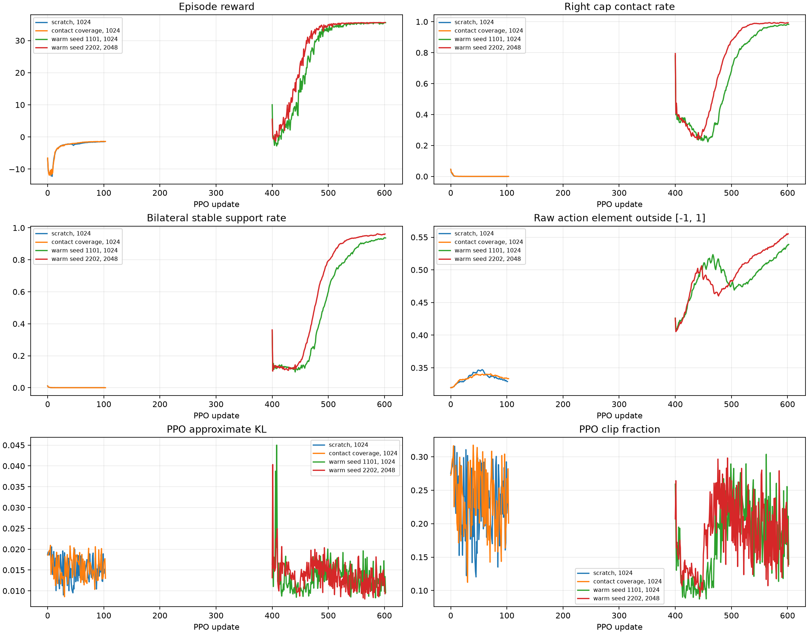
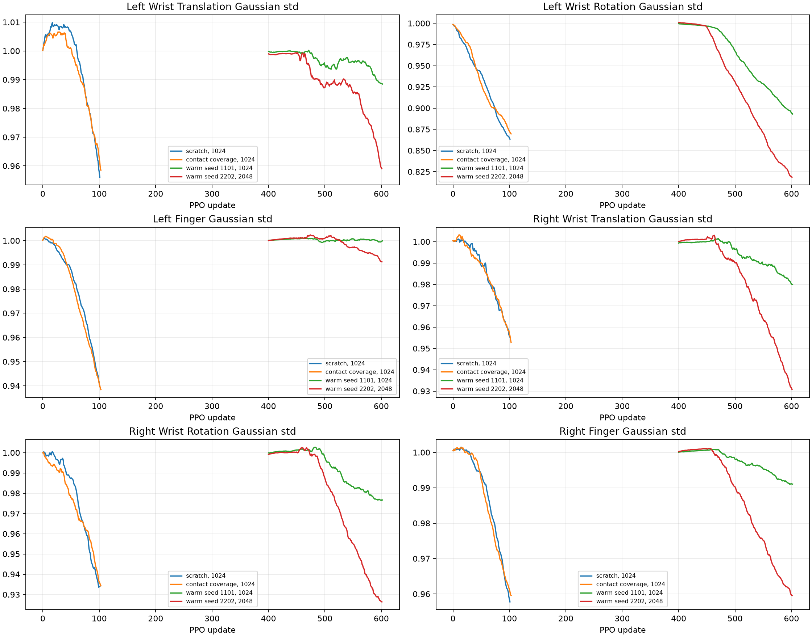
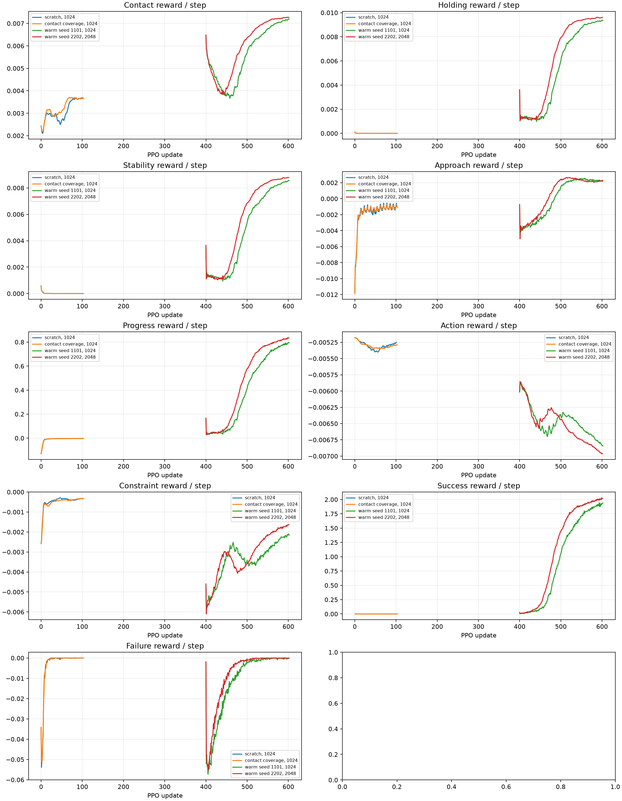
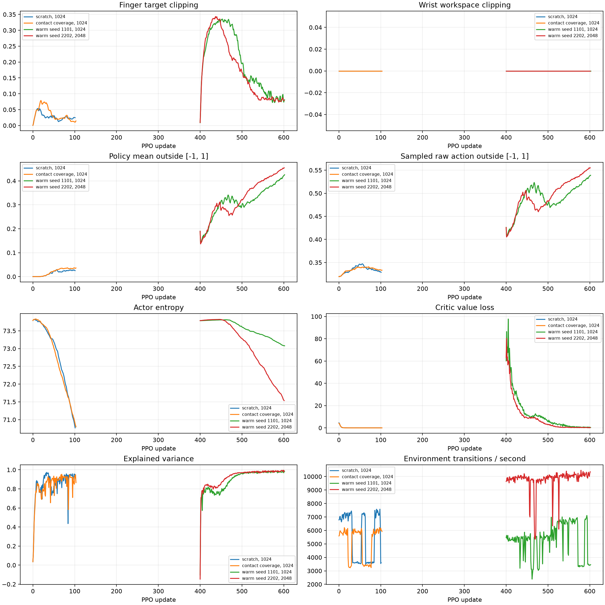

# Phase 1B: unified pregrasp to CapTurn30

Status: **PARTIAL — the two-seed near-contact PPO target passed with a
single-policy warm-start; physical velocity consistency, action saturation
and distant natural pregrasps remain unresolved.** This report records actual
outcomes only. Training checkpoints, TensorBoard events and
raw contact traces remain in ignored `logs/` and `artifacts/phase1b/`.

## Task contract

Registered ID:
`DexterousHands-WujiHand2-Bimanual-PregraspCapTurn30-Direct-v0`.
One 52D Gaussian Actor commands both 20-joint official WujiHand2 Beta 1
hands and both ideal pose-command wrists at 50 Hz. PhysX runs at 500 Hz.
The cap and bottle are dynamic under gravity. The task uses the PGS Mimic
screw at 3 mm pitch. Neither object receives a per-step pose write or
scripted cap torque. The new task has its own configuration, reward, strict
five-step Success, and frozen pregrasp bank. Old GraspHold and CapTurn task
IDs and checkpoints remain available. Finger and bottle mechanical values
are engineering candidates, not hardware-calibrated measurements.
Each 52D action is ordered as left wrist 6D, left fingers 20D, right wrist
6D, right fingers 20D. Nonfinite elements become zero, then each element
is clamped to [-1, 1]. One command maps to at most 0.5 mm per wrist
translation coordinate, 0.02 rad per wrist rotation coordinate and 0.01
rad per finger target increment. Finger targets accumulate from the Reset
joint targets and are clipped to the official joint limits. Wrist targets
accumulate from the Reset wrist poses and use a 0.6-m radial workspace,
0.1-m minimum height, 0.15-m/s linear and 1-rad/s angular trajectory
limits. The wrist is an ideal pose-command boundary; these bounds do not
turn it into a floating-wrist force controller.

Actor observations are 277D and include Oracle Object State for bottle and
cap poses/velocities; they exclude contact forces and internal screw state.
The 421D critic adds privileged contact and thread quantities. The precise
field schema is in the new task's `OBSERVATION_SCHEMA.md`.

## Reset bank and reachability

The 51-row frozen bank has SHA-256
`fcf06057a357e23528b22fc049f8c2607f195b4712f5b410525daf83b7d33193`.
It contains 37 near-contact A rows and 14 weak-contact B rows, all from
**one relative template family**. Train/evaluation local source seeds are
globally disjoint across levels in `phase1b_pregrasp_split.json`.
The split manifest SHA-256 is
`adf9dff639dfc147063e76977129de35e840acd586af56b0b955ad1175cee3d5`;
the fixed evaluation simulator seed is 9117. The globally held-out natural
source seeds are 1625, 1779, 1831, 1842, 1881 and 2261.
The A partition, frozen before PPO, is 29 train / 8 evaluation rows; B is
6 train / 8 evaluation rows. World transforms are not counted as a new
relative grasp family.

The source generator first rejected natural-derived candidates: a PGS
active probe reached valid bilateral contact before the bottle fell in
0/22 initial A candidates. Hybrid candidates use a partially opened
stable-derived left preshape and an opposed natural right tripod whose
offline MJCF Jacobian fit places thumb/index/middle near the cap sidewall.
In native 50/500 Hz PGS simulation, the 51 admitted rows reached correct
bilateral contact under ordinary finger-target actions in 1–8 policy steps
(mean 2). None reached full bilateral contact in the first 15 zero-action
probe steps. The active probe's minimum bottle height was 0.495 m, maximum
correct contact force 5.35 N, maximum cross-object hand force 0 N, maximum
pitch error 3 μm, and first-step reported signed separation −0.092 mm.
The zero probe showed substantial drop in some B states (minimum 0.128 m),
which is why an active, time-limited contact opportunity matters.

PGS Mimic still has a screw-velocity discrepancy: admitted active probes
showed up to 1.27 rad/s absolute bias between PhysX screw velocity and
pose-differenced angular velocity. The earlier Phase 1 contact trace
reported −2.22 mm signed separation; that number is a PhysX contact
distance and has **not** been proven equal to exact geometry penetration.
Neither issue is treated as solved by the new Reset bank.

## Tests and baselines

1/2/16/1024/2048-environment Reset/Step smoke probes passed with finite
277D actor and 421D critic observations. The 1024-env 20-step physics probe
reached ~8,001 transitions/s and the 2048-env probe reached ~11,168
transitions/s, measured without PPO updates. At the final zero-action step
the 2048-env left/right contact rates were 96.0% / 0%. All 17 focused
Phase 1B numerical and registration tests passed on the final candidate.
The broader suite yielded 196 passed, 1 skipped and 2 failures
in preexisting Allegro temporary-asset and MANO keypoint-order tests; these
belong to separate user work and have not been modified here.

On the eight frozen A evaluation rows, all with 200 episodes:

| Actor/policy | Success | Additional observation |
|---|---:|---|
| Zero action | 0/200 | Bottle stays stable; occasional right contact, no opening. |
| Gaussian random | 0/200 | 95.5% failure; isolated 2.29 rad maximum opening never passed physical Success. |
| From-scratch baseline, new update 25 | 0/200 | Left contact persists, right contact absent; ~75 mm mean bottle drift. |
| From-scratch baseline, new update 100 | 0/200 | Right contact absent; ~53 mm mean bottle drift. |
| From-scratch contact-coverage reward, update 50 | 0/200 | No stable bilateral support. |
| From-scratch contact-coverage reward, update 100 | 0/200 | No stable bilateral support. |
| Old stable-state CapTurn Actor, direct transfer without new PPO | 9/200 | 4.5%; 91% episode failure; one actor only. |
| Same direct-transfer Actor, right hand moved away | 0/200 | 100% failure. |
| Same direct-transfer Actor, left hand moved away | 0/200 | 100% failure. |
| Warm-start PPO, seed 1101, 51 new updates (`model_450.pt`) | 200/200 | Near-contact A; 23.9% raw deterministic action elements out of range. |
| Same checkpoint, held-out weak-contact B | 129/200 | 64.5%; 31.1% raw action overflow. |
| Warm-start PPO, seed 1101, 101 new updates (`model_500.pt`) | 200/200 | Near-contact A; 28.0% raw action overflow. |
| Same checkpoint, held-out weak-contact B | 200/200 | 26.0% raw action overflow. |
| Warm-start PPO, seed 1101, 201 new updates (`model_600.pt`) | 200/200 | A saturated; raw action overflow worsened to 39.5%. |
| Warm-start PPO, seed 1101, held-out original distant D | 0/200 | Evaluated `model_450.pt`; 100% failure. |
| Warm-start PPO, seed 2202, 2048 env, 51 new updates (`model_450.pt`) | 200/200 | Near-contact A; 26.2% raw deterministic action overflow. |
| Same seed-2202 checkpoint, held-out B | 148/200 | 74%; all eight held-out local rows represented. |
| Warm-start PPO, seed 2202, 2048 env, 101 new updates (`model_500.pt`) | 200/200 | Near-contact A; 31.9% raw action overflow. |
| Same seed-2202 checkpoint, held-out B | 200/200 | 31.1% raw action overflow. |
| Warm-start PPO, seed 2202, 201 new updates (`model_600.pt`) | 200/200 A, 200/200 B | No success gain; action overflow 44.0% A / 44.5% B. |
| Selected seed-2202 `model_500.pt`, held-out original distant D | 0/200 | 100% failure; 22.5% ground contact; 60.3% raw action overflow. |

The 9 direct-transfer successes ended in 14–30 policy steps. All had
continuous five-step bilateral support, correct objects in contact, 0.71–1.44
rad opening, 0.343–0.699 mm axial travel, <=10.7 μm screw constraint
error, <=17.8 mm bottle displacement and no angle-jump fault. Those angles
show appreciable overshoot beyond 30° and require separate diagnosis.
They are not evidence that a new PPO policy learned pregrasp control.

The previous CapTurn checkpoint still replayed 200/200 on its same single
stable Reset row after the stricter bottle-stability Success gate was added.
This is only a regression baseline, not a Phase 1B result.

The unified reward's contact scores saturate in [0, 1], approach is a
telescoping signed potential, and positive opening progress is credited
only under stable bilateral support and pitch consistency. Opening progress
is capped at 30°. At 50 Hz over the five-second episode, the maximum
non-turn dense return is 8 for the baseline profile and 22 for the
contact-coverage ablation; both are below the one-time 25-point Success
bonus. Numerical tests reject nonfinite inputs, angle jumps and progress
without correct support. The grasp anchor is captured once when a valid
grasp first appears within 20 mm of the Reset reference, then remains fixed
after later contact loss, so drift cannot be hidden by a moving reference.

The warm-start checkpoint filename uses the source runner's global
iteration number. Because the transferred source is at iteration 400, the
`model_450.pt`, `model_500.pt` and `model_600.pt` rows represent 51, 101
and 201 new updates respectively. The selected seed-1101 checkpoint is
`model_500.pt`: it is the earliest
sampled checkpoint with 200/200 on both A and B. The 200 A successes at
`model_450.pt` lasted 13–16 policy steps and reached 0.725–0.930 rad true
relative opening, 0.346–0.444 mm axial travel, <=16.7 μm screw constraint
error and 9.0–12.6 mm bottle translation. Every trajectory retained correct
bilateral contact and passed the five-step stability gate. Both A and B
evaluation cover eight local held-out reset rows; this is **within one
relative template family**, and D remains unsolved.

Selected-checkpoint counterfactuals on A: zero action, random Gaussian
action, no right hand, no left hand, no hands, and a pure reverse-wrist
action each scored 0/200. A separate test that reversed only the right-wrist
rotation component while retaining all other learned actions scored 3/200;
those cases are genuine positive cap rotations caused by the retained
commands, so this is not a pure reverse-action negative control. Numeric
tests reject missing contact, nonfinite angle and a 6.74-rad single-step
opening jump.
The `no_hands` mode places both hands out of contact and zeros all commands,
leaving the bottle/cap dynamics and Mimic constraint active.

An additional same-initial-pose control uses seed-2202 `model_500.pt` while
freezing one hand's 26 actions at zero without moving it away at Reset.
Freezing the **left** hand scored 0/200 A versus 200/200 for the full
policy; left contact still occurred in 93.7% of observed steps, but right
cap contact collapsed to 0.1% and stable bilateral support to 0.1%.
Freezing the **right** hand likewise scored 0/200, with only 0.7% right
cap contact and 0.4% stable bilateral support. These controls show that
both hands' active policy commands are necessary in this evaluated family;
simple presence of the left hand at Reset cannot explain success.

A 500-Hz trace of one successful held-out A trajectory records 1,298
right-hand/cap manifold points, no contact-buffer overflow, maximum screw
constraint error 8.67 μm, left/right peak normal force 41.8/25.8 N and
minimum PhysX signed separation −1.842 mm. The true relative cap opening
was 0.832 rad; the bottle rotated 0.106 rad while the cap rotated 0.855
rad in world coordinates. PhysX screw velocity differed from adjacent-pose
angular speed by up to 6.60 rad/s (mean absolute 1.25 rad/s); integrated
PhysX velocity yielded 0.771 rad versus the 0.832-rad true pose delta.
The 20-ms window discrepancy peaked at 0.0213 rad. These discrepancies,
and the signed contact separation, remain physical-model concerns; signed
separation alone is not a verified geometric penetration depth.
The cap collision is a twelve-segment cube shell plus a top cylinder; its
visible shell is a separate mesh. Transforming the 1,298 reported contact
points into the cap frame gives radial positions 15.44–17.69 mm around a
17.00-mm nominal outer radius (median 16.50 mm), and heights −2.14 to
8.70 mm within the cap's 12.5-mm half height. Signed separation ranges
from −1.842 to +0.414 mm (median −0.643 mm). The proxy geometry and contact
offsets therefore need a direct shape-level audit before those distances
can be interpreted as exact material overlap; no contact threshold was
relaxed to make the rollout pass. The generated cap USD authors no
`contactOffset` or `restOffset` attributes; the effective runtime PhysX
defaults and the hand collision geometry have not yet been measured.

## PPO experiment ledger

The task's std=1.0 Gaussian baseline, 1024 envs, 32 steps/env/update,
seed 1101, from scratch, ran 102 updates (~3.34 million new transitions)
before the explicit no-progress/action-saturation stopping rule was used.
The saved `model_100.pt` scored 0/200. PPO mean reward rose while right
contact and bottle stability fell to zero, and policy-mean elements outside
`[-1,1]` rose from 0 to ~2.5%.

The controlled `contact_coverage` reward profile changed only dense
contact/proximity/stability terms. Its 5-second no-turn return has a tested
upper bound below the +25 Success bonus. At the same seed, bank, actor,
action mapping and 1024-env PPO configuration, it ran ~102 updates; its
`model_100.pt` also scored 0/200, with ~3.5% policy-mean action overflow.
The first two launches of this profile did not complete a PPO update because
new profile-specific reward names were absent from the Episode accumulator;
the regression test and accumulator fix are now in the repository. They are
excluded from transition accounting.

The third experiment initializes the **same single Actor/Critic** from the
old CapTurn checkpoint and restores learnable Gaussian std to 1.0. It uses
the baseline reward, same seed and frozen A training split, and 1024 envs.
It completed 201 new updates (6,586,368 transitions) before early stopping:
A/B success was saturated by global iteration 500 while deterministic action overflow
rose from 28.0% there to 39.5% by global iteration 600. The old checkpoint
itself scored only 9/200 A, so the improvement is due to additional PPO
training on the new task. This is explicitly a warm-start result. The two
from-scratch controlled runs each consumed approximately 3.34 million
transitions and scored 0/200.

The fourth experiment uses the same old Actor warm-start, independent seed
2202 and **2048 parallel environments**. It completed 201 new PPO updates
(13,172,736 transitions), with valid PPO losses and approximately
9,500–10,000 transitions/s during later iterations. At 51 new updates it
already scored 200/200 A and 148/200 B; by 101 updates it scored 200/200
on both. At 201 updates A/B remained 200/200, while deterministic action
overflow rose from 31.9% to 44.0% on A and from 31.1% to 44.5% on B.
It was stopped by the explicit success-plateau/action-saturation rule at
201 updates despite a 300-update command limit. `model_500.pt` is the
selected second-seed checkpoint. Both seeds fail the original distant D
evaluation (0/200), so no distant-pregrasp generalization is claimed.

The four valid PPO experiments added 26,443,776 transitions in this round:
3,342,336 in each from-scratch controlled run, 6,586,368
in the first warm-start run and 13,172,736 in the second. This is an
accounting figure, **not a transition cap**. The two failed reward-profile
launches performed zero PPO updates and are excluded. The second 2048-env
run's mean episode reward reached about 35.6, stable bilateral-support rate
about 96%, approximate KL about 0.018 and explained variance about 0.991
near update 185; the raw sampled-action out-of-range fraction was already
54.4%. These health metrics explain the early stop and the preference for
the earlier selected checkpoint.

The seed-1101 warm-start training curve shows mean episode reward rising
from approximately 10 at the first new update to 34 by roughly 100 new updates, while
the measured bilateral stable-support rate rises to roughly 59% at that
point. At the final update it reaches roughly 94%. PPO approximate KL is
about 0.02 around global iteration 500, explained variance about 0.97, and the critic
value loss about 5.7. The six logged Gaussian std groups remain near 1.0
except the left-wrist rotation group, which decreases to about 0.90 by
global iteration 600. Around global iteration 500 approximately 29% of policy-mean elements and
47% of sampled raw action elements lie outside [-1, 1]; the environment
clamps them. Finger target clipping reaches about 19% at that update,
whereas wrist workspace clipping is zero. This is a significant action
parameterization limitation even though real held-out success improves;
simply lowering std is not a demonstrated solution. The first two
from-scratch runs showed rising reward without valid cap contact, so they
were stopped rather than extended blindly.
For a unit Gaussian centered at zero, 31.7% of scalar samples already fall
outside [-1, 1]; the learned nonzero means raise this further. The
deterministic policy's 28–40% overflow is separate evidence that the
actor has learned to rely on action clipping. Because the controller
accumulates clipped wrist and finger targets, many distinct raw Gaussian
actions produce the same command. A bounded distribution with a correct
PPO log-probability and ratio is the most valuable next controlled action
experiment; changing std alone would not test this mechanism.

The selected seed-2202 `model_500.pt` remained 200/200 in a repeat A
evaluation after the final telemetry edit. Measured over the full 20-ms
policy window, mean actual left/right wrist translation speeds were
0.031/0.018 m/s and angular speeds 0.999/0.999 rad/s. The bottle averaged
0.5004 m height, 0.0197 m/s linear speed and 0.223 rad/s angular speed;
the finger-target clip fraction was 4.4% and wrist workspace clipping was
zero. A previous telemetry implementation sampled only the last 2-ms
PhysX substep and falsely read 0 m/s linear wrist motion; the corrected
full-window computation has a numerical regression test and a native
simulation smoke. This telemetry change did not alter actions or rewards.

The committed diagnostic figures show all four PPO runs. The warm-start
x-axis uses the source runner's global iteration 400–600, whereas the
from-scratch x-axis begins at zero. Short throughput dips during the
warm-start runs coincide with concurrent independent evaluations.









## Reproduction and raw artifacts

Run from the repository root with the project Isaac Lab launcher and
`WUJI_DESCRIPTION_ROOT` pointing to the official WujiHand2 description.
The exact old checkpoint path below is the initial single-policy transfer.
The frozen bank and split manifest are checked into `docs/assets/`.

```bash
export ISAACLAB_PYTHON=/home/ubuntu/miniconda3/envs/allo_track/bin/python
export WUJI_DESCRIPTION_ROOT=/tmp/wuji-description-v2026.9.11
export PYTHONPATH=/home/ubuntu/dexgym
OLD=logs/rsl_rl/dexteroushands_bimanual_bottle_phase1/2026-11-01_19-04-52_capturn_pgs_from_grasp_2048_std1_seed42_300iter/model_400.pt
scripts/run_isaaclab.sh scripts/rsl_rl/train.py \
  --task DexterousHands-WujiHand2-Bimanual-PregraspCapTurn30-Direct-v0 \
  --num_envs 1024 --seed 1101 --max_iterations 400 \
  --run_name phase1b_seed1101_A_legacy_actor_warmstart_1024 \
  --init_checkpoint "$OLD" --reset_loaded_action_std --init_action_std 1.0 \
  --unified_reward_profile baseline --source_bank_snapshot docs/assets/phase1b_pregrasp_bank.json \
  --source_bank_snapshot docs/assets/phase1_mimic_pgs_grasp_init_bank.json \
  --viz none --device cuda:0
scripts/run_isaaclab.sh scripts/rsl_rl/train.py \
  --task DexterousHands-WujiHand2-Bimanual-PregraspCapTurn30-Direct-v0 \
  --num_envs 2048 --seed 2202 --max_iterations 300 \
  --run_name phase1b_seed2202_A_legacy_actor_warmstart_2048 \
  --init_checkpoint "$OLD" --reset_loaded_action_std --init_action_std 1.0 \
  --unified_reward_profile baseline --source_bank_snapshot docs/assets/phase1b_pregrasp_bank.json \
  --source_bank_snapshot docs/assets/phase1_mimic_pgs_grasp_init_bank.json \
  --viz none --device cuda:0
```

For a fixed held-out evaluation, use the selected model path in
`--checkpoint` and change `--level` between A, B and D. The evaluator
writes both aggregate and episode-level JSON, and `--policy` also accepts
`zero`, `random`, `no_right`, `no_left`, `no_hands`, and `reverse`.
`freeze_left` and `freeze_right` retain the same Reset pose and mask only
that hand's policy action.

```bash
scripts/run_isaaclab.sh scripts/environments/evaluate_phase1b.py \
  --checkpoint logs/rsl_rl/dexteroushands_pregrasp_capturn30_phase1b/2026-11-01_23-20-26_phase1b_seed1101_A_legacy_actor_warmstart_1024/model_500.pt \
  --policy learned --level A --episodes 200 --num-envs 64 --seed 9117 \
  --output artifacts/phase1b/eval_warmstart_model500_A.json \
  --rows-output artifacts/phase1b/eval_warmstart_model500_A_rows.json
```

Raw PPO consoles, TensorBoard events and checkpoints are under
`logs/rsl_rl/dexteroushands_pregrasp_capturn30_phase1b/` and
`artifacts/phase1b/`. In particular, the selected first-seed checkpoint
is `2026-11-01_23-20-26_phase1b_seed1101_A_legacy_actor_warmstart_1024/model_500.pt`.
The 500-Hz successful trace is
`artifacts/phase1b/eval_warmstart_model450_A_500hz_trace_with_pose.json`.
The direct-transfer, from-scratch, reward-ablation, selected-checkpoint
and counterfactual evaluation JSON files all use the `eval_*.json` naming
scheme in that same artifact directory. Checkpoints, event files and trace
JSON are ignored by Git because they are large; the code, frozen reset
bank and experiment report are committed.

## Gate status

| Gate | Status | Evidence or remaining work |
|---|---|---|
| A — task | Pass | Registration, 52D action, 1/2/16/1024/2048 Reset/Step, real PPO updates and deterministic replay. |
| B — physical | Partial | Dynamic contacts, gravity, screw Reset and counterfactuals validated; PhysX screw-speed bias and deep signed contact distance remain unresolved. |
| C — learnable pregrasp | Pass, one family | A/B 51 active-reachable candidates; zero-action probes cannot establish bilateral support; B policy succeeds. Wider family coverage remains future work. |
| D — 1024+ PPO | Pass | Actual 1024-env and 2048-env 201-update PPO runs, checkpoints and deterministic replay. |
| E — held-out learning | Pass, warm-start | 9/200 before new PPO versus 200/200 A/B after 101 new updates, controls 0/200. From-scratch PPO failed. |
| F — two-seed >=20% | Pass, warm-start | Independent seeds 1101 and 2202 each reached 200/200 A and 200/200 B after 101 new updates on frozen held-out cases. Both fail D at 0/200. |
| G — health | Fail to certify | No NaN/Inf or PPO explosion in valid runs, but deterministic action overflow rises to 39–44% at late checkpoints and PGS screw-speed bias remains. |
| H — regressions | Partial | Old stable CapTurn 200/200 and Phase 1B tests pass; complete suite has two unrelated, preexisting Allegro/MANO failures. |
