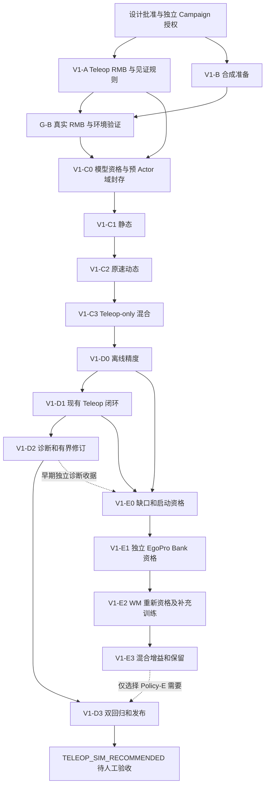

# S0-5 研发路线 v2.0.1

状态 DRAFT_READY_FOR_REVIEW。项目用户确认研究方向。V1 技术阶段启动须同时具有设计批准和独立有界 Campaign 授权。

C1–C3 和 D0 持续核对 C0 资格。D2 开始后可先提交接口核查和缺口归因收据，供 E0 决策，E0 无需等待 D2 完成，D2 的技术结案也不等待 E3。D2 保存证据、原 checkpoint 和每轮复验，D3 统一选择。仅选择 Policy-E 时须 E3 通过及独立 D3 审议，采用 Policy-T 的路径在 E 未触发、阻塞或失败时仍有效。E 扩充前先完成 Teleop-only D0 和 D1，禁止以两份回归录包作新增训练来源。

| 阶段 | 硬依赖与证据 |
|---|---|
| [V1-A](specs/V1-A_offline_rmb.md) · [V1-B](specs/V1-B_residual_environment.md) | A 来源、M1 选择和连续性；B 合成准备可并行，实际通过须 A。 |
| [V1-C0](specs/V1-C0_world_model.md) · [V1-C1](specs/V1-C1_static.md) · [V1-C2](specs/V1-C2_dynamic.md) · [V1-C3](specs/V1-C3_mixed.md) | C0 通过 54 轴独立 WM 与预 Actor 域证据；C1–C3 按序通过已有门。C3 初始为 Teleop-only。 |
| [V1-D0](specs/V1-D_evaluation_deployment.md) | C0/C3 技术证据和冻结评分。实际 MuJoCo 绝对低误差、相对收益、全域、功能与安全门。 |
| [V1-D1](specs/V1-D_teleop_replay_and_refinement.md) | D0 通过后，现有软件链路功能、安全、回退和实际 T0/T1/T2 录包回放。阶段收录性能诊断，最终收益由 D3 判断。 |
| [V1-D2 / V1-D3](specs/V1-D_teleop_replay_and_refinement.md) | 接口优先归因，有界修改和实际证据；D3 同一候选重跑 D0 与两包 Teleop 并满足性能门才授予首版推荐。 |
| [V1-E0 / E1](specs/V1-E_conditional_egopro_augmentation.md) · [V1-E2 / E3](specs/V2_1_egopro_training_and_regression.md) | D0/D1 通过、D2 已确认分布缺口，E0 独立审查；E1 数据资格；E2 新域实际 WM 资格后才更新 Actor；E3 共同 Teleop、EgoPro 独立评价及两包回归。 |

**诊断出口**是独立操作。具可信 checkpoint、数据、功能、安全、因果和导出等价证据的中间失败可独立输出诊断包，最高为 EXPORTABLE。阶段原失败继续记录，诊断不得赋予 D1 启动、D3 通过或推荐权限。D1 已有合格现有链路功能证据但 D3 性能未过时，可保留实际验证的较低等级。

历史 P00–P02 保持原签核。P03–P08 迁移的仿真规格仍按原编号入口定位。P09 科研终评、真实时钟、遥测、物理基座、现场批准和真实设备操作继续单独门禁。 [v2.0.0 路线](https://github.com/FEGkkd/dexgym/blob/f78ee27f4762fedca9529bf697560bb267f8c704/docs/s0-5/ROADMAP.md) · [自主执行](MULTI_AGENT_PROTOCOL.md)
