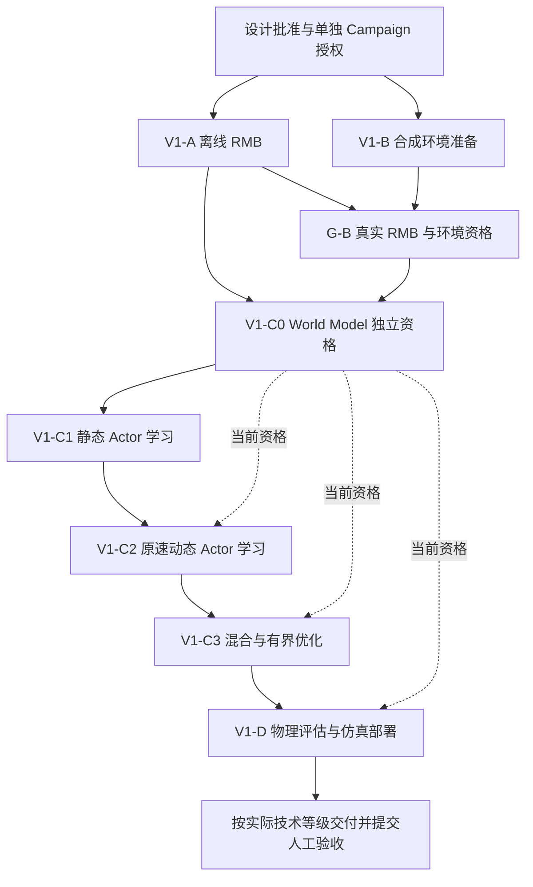

# S0-5 研发路线 v2.0.0

`DRAFT_READY_FOR_REVIEW`。设计批准、单独 V1 Campaign 授权与阶段技术结果分别登记。此路线尚无执行授权。历史设计以原 Git 对象可追溯。[原路线](https://github.com/FEGkkd/dexgym/blob/b8d8b401bdda59ad00a37f0a3bf6878b462ed756/docs/s0-5/ROADMAP.md) · [状态](PROJECT_STATE.md)

## V1 技术依赖

经授权后，V1-A 与 V1-B 可在授权后使用隔离合成数据与 V1-A 并行准备，正式 G-B 依赖 G-A 且须复验实际 RMB 接口。C0 再核验真实数据与物理采样一致性。V1-C1–C3 Actor 更新及 V1-D 入口依赖当前版本 World Model 资格。V1-D 须经 G-C3 才能启动。V1-D 仅性能门未过时可交付实际验证的较低等级。上游技术失败可保存检查点及诊断并提交审阅。退出、回退与复验仍使用同一预算。 [自主研发规范](MULTI_AGENT_PROTOCOL.md)

| 阶段 | 关键输入和必须关闭的技术门 | 产物 |
| --- | --- | --- |
| [V1-A 离线 RMB](specs/V1-A_offline_rmb.md) | 批准的 HMB + M1 连续仿真限定用途。来源、连续性、因果、几何、共同改善域规则及完整分母由独立审查签署技术记录 | 三层数据、可重放名义适配、窗口索引、各域和证据清单 |
| [V1-B 环境与适配](specs/V1-B_residual_environment.md) | 合成 RMB 接口；安全互锁、CPU/GPU、54 轴、B0 零残差、精确 R/O/A 与实际 MuJoCo transition 写入及 smoke | 同一采样、评估、导出契约和仿真模型 |
| [V1-C0 World Model](specs/V1-C0_world_model.md) | A/B PASS；真实 RMB GPU 读入及来源身份；实际激励和独立留出；一步、多步、静态、梯度、时序、边界及模型利用门 | World Model、持久 Replay / 资格与可复现适用域 |
| [V1-C1 静态](specs/V1-C1_static.md) | C0 当前资格；最低静态学习有效性、安全、对捏与停稳检查 | 带验证结果的静态 checkpoint 与课程记录 |
| [V1-C2 原速动态](specs/V1-C2_dynamic.md) | C1 PASS 及 C0 仍有效；动态最低收益、停止/反向/协调、静态保留 | 连续动态回放与 checkpoint |
| [V1-C3 混合](specs/V1-C3_mixed.md) | C2 PASS；预算内混合、困难域和有限仿真扰动，模型误差与实际失败监控 | 候选列表、最后合格 checkpoint、有效资格记录或失败诊断 |
| [V1-D 评估与部署](specs/V1-D_evaluation_deployment.md) | C3 技术通过且 C0 当前资格有效；独立 MuJoCo 公平评估、Actor 导出、无 Bank 实际推理、连续仿真和安全 | `EXPORTABLE` / `SIM_DEPLOYABLE` / `SIM_RECOMMENDED` 的实际技术候选、完整独立报告与运行依赖 |

## 旧阶段迁移和独立义务

| 原阶段 | V2.0 位置及继承的义务 |
| --- | --- |
| [P00](specs/P00_architecture_and_audit.md) | 历史审计与批准有效。本轮修订作为独立 DCR 和冻结候选审计 |
| [P01 历史 HMB](specs/P01-data-v0.2.1.md) | 原验收及 Train/Validation、QC、模拟因果授权保持原有范围，V1-A 消费已签署 E1/F1 产品 |
| [P02 历史研究](specs/P02_intent_and_feasibility.md) | 原静态有限验收和历史资格范围保留。V1-A 申请固定 M1 的连续仿真扩展，正式物理评分资格另审 |
| [P03 名义控制](specs/P03_nominal_controller.md) | V1-A 复用 Marvin IK/Wuji SDK，V1-B 验证仿真 Servo 和零残差。新联合求解研究为可选对照。生产 Teleop 接入仍需独立 START、控制频率及命令所有权检查 |
| [P04 任务](specs/P04_rl_environment.md) | V1-B SuperMimic 适配与 V1-C0 活跃 World Model 门；PPO 保留可选后续对照 |
| [P05 静态](specs/P05_static_precision.md) / [P06 动态](specs/P06_dynamic_tracking.md) | V1-C1/C2 工程课程，最终静态和动态毫米级挑战按正式评分报告 |
| [P07 泛化](specs/P07_generalist_tracking.md) / [P08 鲁棒](specs/P08_robustness.md) | V1-C3 基础混合、有限仿真扰动。保留新数据完整泛化、实测域随机化和硬件资格义务 |
| [P09 评估](specs/P09_final_evaluation.md) | V1-D 历史开发评估；独立 Final Test、冻结科研对照、多种子和正式物理评分在后续单独解锁 |
| [P10 部署](specs/P10_deployment.md) | V1-D 独立仿真包，后续现有 Teleop 集成。真实部署先关闭 C2-RT、P01-T、物理 robot-base、Servo、安全和外测，再按人工授权逐步验证 Shadow、HIL 及真实操作 |

历史 `P03-SIM0` 证据及其有限授权独立于本路线。硬件准备、真实数据资格与最终评分采用独立工作轨道，依赖和授权见 [硬件测量计划](specs/HARDWARE_SHARED_MEASUREMENT_PLAN.md) 与 [评估协议](EVALUATION_PROTOCOL.md)。
