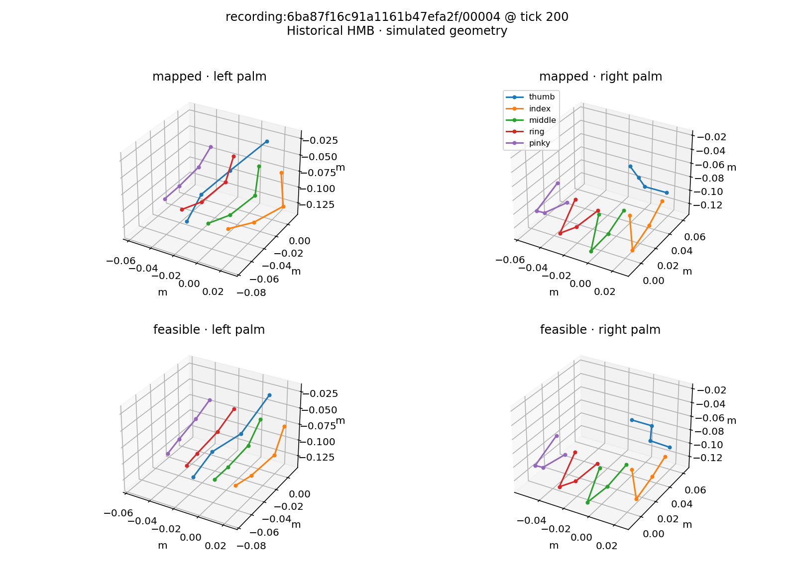
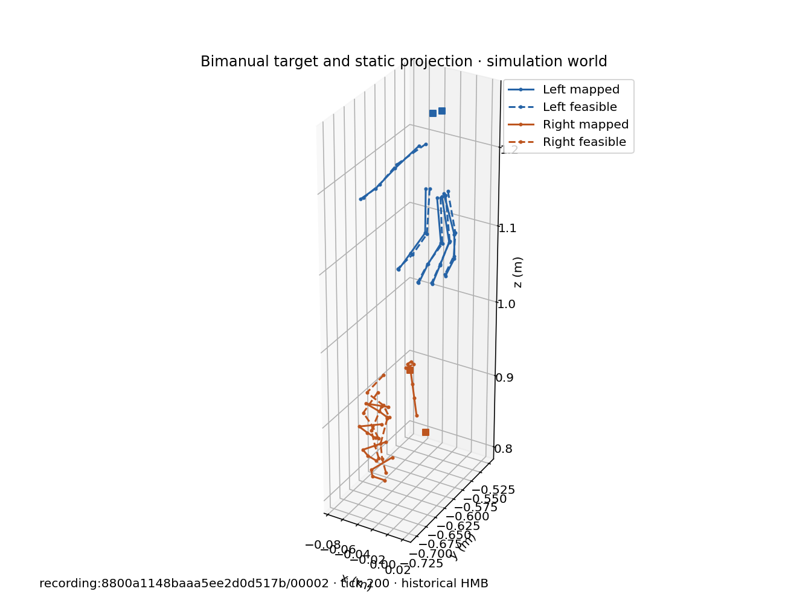

# P02 人体意图、静态可行性与历史 S0-4 诊断

**READY_FOR_REVIEW**。P02 v0.2.0，Run **P02-20261126-54c2e06**。P01-F 和历史 HMB 数据主线已按用户签核登记为 ACCEPTED。P02-A 至 E 的静态研究门通过。正式工作空间评分域待裁定，终局精度挑战尚未达到。C2-RT、物理 robot-base、P01-T、HMB_REALTIME_VERIFIED 和 Independent Final Test 仍为 BLOCKED。[P01 签核](approvals/P01_ACCEPTED_P02.md) · [冻结规格](../specs/P02_intent_and_feasibility.md) · [运行凭据](../evidence/P02/review_receipt.json)

## 1. 正式数据及模型

绑定已批准的 E1 HMB、F1 凭据与 P02 handoff 的精确 SHA。主实验覆盖冻结的 32 个 F1 母源代表拍，Train 24、Validation 8，包含 arm_motion、arm_hand、hand_pose、bi_hand、fruit 五类任务。另列 6 个既知尾部。样本包括动态录制和手型姿态，是有界几何截面。代理速度仅用于选 Train 安装锚及描述样本。E1 归档、QC、split 未改动，独立 Final Test 未访问。[主计划](../evidence/P02/plan.json) · [分层覆盖](../evidence/P02/task_space_summary.json)

当前编译模型为源码中的 hand2_2/generated/dual_arm_marvin.xml，SHA-256 939b3651e2426e596eed482e70a68c2382720df1fd55b124aa5f0893b640e92d。历史 S0-4 采用归档所载 Teleop 模型，SHA-256 be69f387f5bc25c8011a992a88ac2c2449c2c0419e09318b740fcdcd1402871d。两套各锁定 71 个 XML 与引用资产文件，均为 14 臂轴和 40 手轴，54 个命名 hinge 与 54 个驱动逐一绑定。模型契约记录驱动和关节范围交集、符号、零位、左右腕/掌安装以及十个指尖 site。功能点采用模型 site。其相对末端刚体与关联几何的偏差已记录，真实指腹接触点缺外部计量。该实验消费 MJCF，URDF 等价性未实测。J6/J7 包络来源为现有 Teleop 仓库的 test_marvin_kine_sdk.cpp 验证规则，两侧采用 1.025 |q6| + |q7| ≤ 110.5°。当前/历史各有 2,542/3,454 个参与模型碰撞筛查的几何对，覆盖模型启用的环境和自碰撞，实物包络待测。[模型与资产签名](../evidence/P02/model_report.json)

| 量 | 当前 MJCF | 历史 MJCF |
|---|---:|---:|
| 独立复验姿态 | 35 | 35 |
| FK 位置最大误差，m | 1.19e−15 | 1.13e−15 |
| FK 旋转最大误差，rad | 9.64e−16 | 1.20e−15 |
| 位置 Jacobian 最大差，m/rad | 4.82e−11 | 4.84e−11 |
| 旋转 Jacobian 最大差，rad/rad | 3.58e−11 | 3.44e−11 |
| 压测中 MuJoCo 穿透接触数／筛查未覆盖数 | 373／0 | 803／0 |

每套包括 1 个 home、12 个合法随机、10 个单轴、6 个近限位、4 个耦合边界和 2 个低奇异值姿态。参考实现独立遍历编译刚体树，再对解析 Jacobian 作中心差分。步长为 1e−5 rad，代表和边界姿态补做 1e−4 与 1e−6 rad。位置、旋转和 Jacobian 容差为 2e−9 m、2e−8 rad、2e−7。Torch parity 留待未来接入相应运行时。[实际模型审计](../evidence/P02/model_report.json)

## 2. 意图映射和捏合

按原始 25 节点拓扑、父指针、解剖 chain 和 MCP/PIP/DIP/TIP 语义取节点。分侧构造右手掌基，将人骨段方向映射至各侧机器人段长。共享仿真刚体保持双腕相对平移向量，最大数值残差 2.54e−16 m；分侧手尺度 0.714/0.768 和腕安装常量仅由 Train 固定。原始指间距 20 mm 内的近捏合向量在映射内保真至 1e−10 m。代价是主队列末段虚拟目标长度最多变化 7.63 mm。

原抽样近捏合覆盖不足后，预注册了独立补证。读取 32 个签核母源的既有代表拍分区，共 12,627 计划拍；Train 各侧有 9,313 个联合有效拍，左右近捏合为 784/730；Validation 各侧有 3,163 拍，左右为 12/289。四个分层均保留首个真实见证的原始索引和向量。补证没有改变 Oracle 主实验分母。实际 Wuji SDK SHA-256 为 1bdc160c6c27a9b1bfa727dfb7c33c8b01fbb5acbefc8cfdfa17b2fd84c75282。在 36 个有几何目标上运行独立对照，HMB 手部用 Wuji、臂部用本阶段有界腕 IK，历史表 A 读取原存 SDK/IK 关节角。[映射契约](../evidence/P02/mapping_contract.json) · [真实捏合补证](../evidence/P02/near_pinch_witness.json)

## 3. 约束 Oracle 和误差

比较固定 SDK 双手的 14 DoF 与联合 54 DoF。两者使用相同三种初值生成规则、静态残差和预算。每初值至多 90 次 SLSQP 迭代或 8 秒。静态见证复验关节和驱动限制交集、J6/J7、0.5 mm 模型碰撞裕量及独立 FK。216 次初值尝试中，211 次找到合法候选，94 次报告数值收敛，122 次耗尽预算。初值耗时 P50/P95 为 0.170/0.256 秒。54 DoF 有 36 个独立核验见证，其中 5 个达到 5 mm 诊断容差，31 个保留更大残差。两项 Tracker 速度尾部因原几何掩码为 UNKNOWN；固定手对照另有 1 个 SOLVER_TIMEOUT。[评分复核](../evidence/P02/score_integrity.json) · [逐项统计](../evidence/P02/mapping_and_solver_summary.json)

| 组别／方法 | 已评分／计划 | 十指最大误差 P50/P95/P99，mm | 十指同拍 ≤3/5/10/15 mm 帧数 |
|---|---:|---:|---:|
| 主队列／SDK + 有界腕 IK | 32/32 | 61.50 / 248.27 / 281.36 | 0 / 0 / 0 / 0 |
| 主队列／固定手 14 DoF | 31/32 | 38.58 / 220.71 / 282.54 | 0 / 0 / 0 / 0 |
| 主队列／54 DoF | 32/32 | 19.74 / 209.55 / 268.01 | 0 / 5 / 10 / 13 |
| Train 含尾部／54 DoF | 28/28 | 17.09 / 261.28 / 277.14 | 0 / 4 / 10 / 13 |
| Validation 含尾部／54 DoF | 8/10 | 19.74 / 114.47 / 151.58 | 0 / 1 / 1 / 2 |
| 单列尾部／54 DoF | 4/6 | 14.31 / 233.05 / 263.59 | 0 / 0 / 1 / 2 |
| 全部／54 DoF | 36/38 | 18.38 / 249.91 / 276.49 | 0 / 5 / 11 / 15 |

主队列严格配对的 31 个姿态均改善，中位配对差 −16.37 mm。命中率分母含未知和失败，分位数由有见证者计算。全体十指均值、局部地标 RMSE、捏合向量、跨手向量、腕平移、腕 SO(3) 的 P50/P95 分别为 6.81/159.90 mm、5.44/15.27 mm、3.38/18.78 mm、8.68/171.20 mm、53.53/282.58 mm、0.304/0.970 rad。双腕相对平移和相对旋转分别为 72.41/309.51 mm 和 0.453/1.288 rad。各任务分层另存；每指、每点及各样本数值在 Ubuntu 的 study_records.json。

用首轴固定枢轴至目标的距离减去后续链段长度和，独立证明 10/36 个 mapped 目标至少一个指尖的误差下界超过 3 mm，最大下界 245.18 mm。双腕相对尾部的下界为 237.62 mm，实际投影残差 271.22 mm。65.706 μs 代理时间、右腕位置突变和约 60 mm 因果/离线指尖差异保留在选样记录里；无真实物理速度推断。18/36 贴近模型关节限位，18/36 贴近 J6/J7，35/36 在碰撞裕量上方 10 μm 内。额外两例仅将碰撞裕量由 0.5 mm 降到零且保持不穿透，残差分别从 87.67 降至 87.00 mm、279.33 降至 278.95 mm。正式见证继续采用 0.5 mm。非凸求解失败和缺少解析证据的姿态保持其原状态。DCR-003 提请审核工作空间注册及评分适用域。[两例反事实](../evidence/P02/constraint_probe.json) · [DCR-003](../dcr/DCR-003_p02_workspace_registration.md)

## 4. 历史 S0-4 难姿态归因

使用原历史模型、bank_round_2 的历史 validation 目标和有名 rsi_q。选定 checkpoint 保持原 actor 10,000，SHA-256 b708e7e37acdba0e44781501c637b2b96440c309d6f732f4c25e3aa6803f56a3。原配置验证为 14 维、±8° 臂残差、SDK 手固定。原闭环难例停稳 P95 约 39.32 mm、静态指尖速度 RMS 约 0.0165 mm/s。以下数值为本阶段实际重新计算的静态十指最大位置误差，单位 mm。

| 历史姿态 | A 原存 SDK/IK | B 固定手、全合法臂 | B8 固定手、±8° 臂 | C 开放手、±8° 臂 | D 合法 54 DoF |
|---|---:|---:|---:|---:|---:|
| 10148 | 103.5007 | 0.0271 | 12.5841 | 9.4023 | 0.0819 |
| 38378 | 67.0274 | 0.0378 | 11.1359 | 6.0538 | 0.0878 |
| 27552 | 3.3793 | 0.0909 | 0.0857 | 0.0866 | 0.1095 |
| 10226 | 63.4164 | 0.0231 | 3.5885 | 2.2793 | 0.1168 |

通过 B8/C 控制臂残差范围，开放手部可使前两个难例分别再下降 3.18/5.08 mm。B 与 B8 的差异则量化原 SDK 型目标中臂动作范围的作用。B/D 的合法低误差解证明这两个原目标仍有静态改进空间。求解器按完整残差目标选候选，十指最大误差单独统计。历史闭环与 Servo 未重跑，执行环节的具体误差成因仍待测。[原条件及逐例结果](../evidence/P02/historical_hard_case.json)

## 5. 独立评分、证据和复现

按 case_key 绑定 mapped_intent、feasible_scoring_target 和逐点 projection_error。float64 world/local 形状为 [N,2,5,4,3]，对应左右、五指、四地标、XYZ（m）。腕位置 [N,2,3]、旋转 [N,2,3,3]，同手捏合 [N,2,4,3]，跨手向量 [N,9,3]，相对腕平移 [N,3]、旋转 [N,3,3]。q_oracle_offline 独立存储命名关节 [N,54]（rad），仅离线复核。向量残差分别为 feasible−mapped、measured−feasible、measured−mapped；旋转用相对 SO(3) 转角。实际执行状态不进入目标生成器。在线 nominal 和 Actor 禁止读取离线 q、诊断尾部标签、未来或双端插值。后续统一评分于相同冻结目标，同时报告原 mapped 意图和投影残差。正式评分域待审批。本阶段未测物理执行误差。[静态移交](../evidence/P02/P03_scoring_handoff.json)

实际目录 /home/ubuntu/dexgym_worktrees/s0-5，档案 /home/ubuntu/dexgym_data/s0-5/p02/runs/P02-20261126-54c2e06。实际 Python 3.12.3、MuJoCo 3.13.0、NumPy 1.26.4、SciPy 1.11.4。入口为 evidence/P02/run_p02.sh，实用参数依次为 model 02、intent 02 02、tests 02、history 02 02。补证入口为 run_pinch_witness.py、constraint_probe.py 及 seal_p02.py。详细命令、Git SHA、stdout/stderr 和资源证据各自保存。实验目录只写一次，复现使用新序号，独立只读校验对应 archive manifest。发布来自 sealed-02。[命令与运行环境](../evidence/P02/execution_records.json) · [产物 SHA](../evidence/P02/output_sha256.json) · [源码 SHA](../evidence/P02/code_sha256.json)

Model-01 的安全启动路径漏载 MuJoCo，显式绑定实际安装目录后 model-02 通过。Intent-01 因 NumPy 布尔标量不能 JSON 序列化而退出，修正 JSON 边界后按同一计划重跑 intent-02。封存前的检查另记录了早期失败日志字段缺失和捏合覆盖不足，后者经有限真实数据补证完成。SLSQP 中间点裁边警告保留，所有正式结果均经 FK 和约束复验。6 项单测通过，包含真实模型命名/耦合、残差微分、拓扑顺序、捏合、评分向量与输入独立性。未运行动态闭环、真机控制、硬件 Servo、P03 或 RL。

## 6. 验收矩阵

| 门 | 预期 | 实测 | 状态 |
|---|---|---|---|
| P02-A | 双模型和独立 FK/J | 70 个姿态、资产 SHA 和碰撞筛查压力见证 | PASS |
| P02-B | 语义和捏合、Train/Validation 分层 | 36 个 mapped 姿态、四个 split×侧别的真实捏合补证 | PASS |
| P02-C | 多初值合法见证、约束与覆盖 | 36 个验证 q、2 个 UNKNOWN、径向必要条件及碰撞反事实 | PASS |
| P02-D | 原历史同条件定位 | 四例 A/B/B8/C/D，执行因素保持未知 | PASS |
| P02-E | 独立共同目标与移交 | 不可变静态诊断目标，正式评分域待批 | PASS |
| 最终 3 mm 挑战 | 原意图同拍十指达到要求 | 主队列 0/32，DCR-003 待批 | 未达成 |

P02 停在人工审核节点。P03 的独立前置为 P02、P01-T、C2-RT 和物理 robot-base 全部 ACCEPTED。
