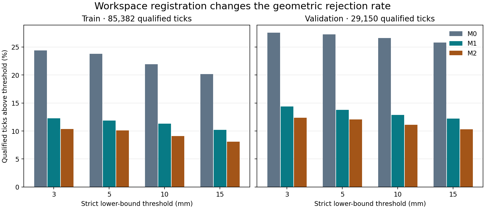
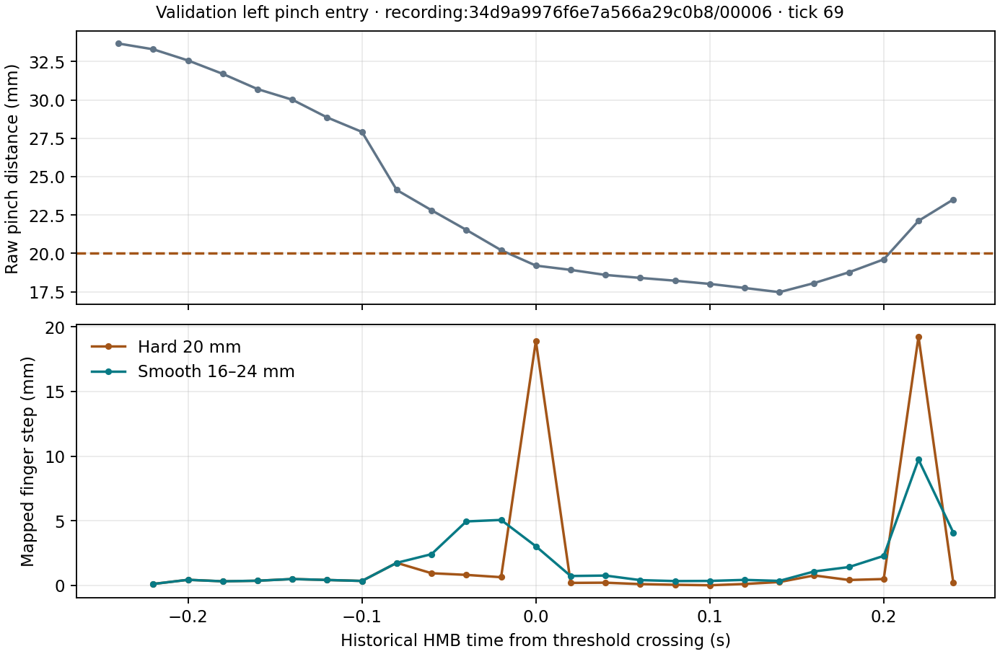
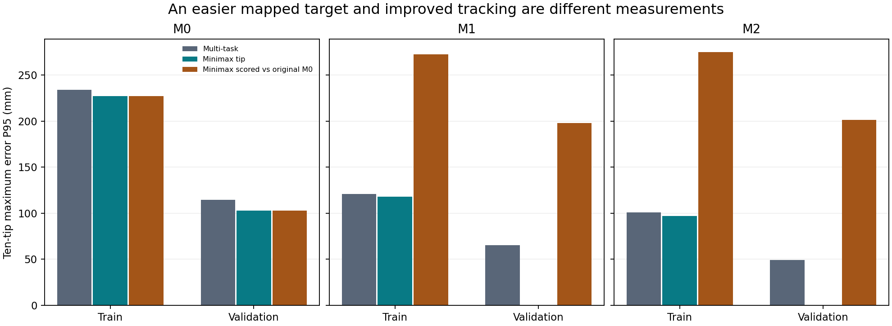

# P02 工作空间映射与 Oracle 复查

**P02 保持 READY_FOR_REVIEW。正式评分域待人工裁定。** 本轮 Run 为 P02-REFINE-20261126-8753921，审核基线 87539210e60f1134820b9f06fdb084cbc3ec1bf1。用户授权 DCR-003 专项静态研究。P01 ACCEPTED，C2-RT、物理 robot-base、P01-T 和独立 Final Test 均为 BLOCKED。P03、RL 和真机操作保持未启动。[运行凭据](../evidence/P02/refinement/execution_receipt.json) · [冻结实验计划](../evidence/P02/refinement_plan.json)

## R-P02-01 捏合统计修复

用 [0]、[1]、[0,2] 和空索引运行回归。旧实现出现三项可复现的索引语义失败。修复后按列表长度计配对，逐项取对应误差。原 38 个记录中，活跃配对从误报 1 对修正为 **3 对**，映射前向量误差 P50 从 47.75 mm 修正为 **28.67 mm**，映射后最大 6.99e−18 m。只修复聚合统计，原几何、静态解、报告和 SHA 保持归档。[旧版反例](../evidence/P02/refinement/semantic_red.txt) · [归档重算](../evidence/P02/refinement/pinch_statistics_correction.json)

## R-P02-02 全量工作空间及注册

通过正式 Reader 复算全部 308 分区。Train 85,382 / 86,338 拍、Validation 29,150 / 30,275 拍为联合有效，共 **114,532 拍**。剩余 2,081 拍为既有 HMB 无效，合格集合没有新增几何 UNKNOWN。每母源和任务保留两个腕位置、腕中点、间距、相对方向及 SO(3)、十指相对第一轴枢轴的坐标和径向界。两侧五指的最大链长半径约为 0.873、0.920、0.923、0.916、0.903 m。原始腕间距 P50／P95 在 Train 为 410／660 mm，Validation 为 403／678 mm。[Train 全量结果](../evidence/P02/refinement/train_workspace_summary.json) · [Validation 全量结果](../evidence/P02/refinement/validation_workspace_summary.json)

M0 使用原冻结的单锚点刚体和腕安装。M1 使用 24 个 Train 母源等权的 7,256 个样本，拟合共享重力轴偏航与平移，尺度固定为 1。损失是目标超出链长半径的平方，加上腕位家位距离和弱变换正则。M1 相对 M0 偏航 −6.04°，平移改变量约 [112.49,189.14,17.70] mm。M1 在全 Train 上仍有 12.25% 超过 3 mm 严格必要界，高于预注册 2% 触发值，故执行 M2。M2 在共同腕中心对腕平移采用 **0.88708** 的共享尺度，局部手掌骨长及同手捏合保持原值。两种参数均在 Validation 几何读取前封存；它们是软件仿真注册。[冻结的 Train 参数](../evidence/P02/refinement/fitted_candidates.json)

| Split／映射 | >3 mm | >5 mm | >10 mm | >15 mm |
|---|---:|---:|---:|---:|
| Train M0（85,382） | 20,819（24.38%） | 20,307 | 18,723 | 17,200 |
| Train M1 | 10,457（12.25%） | 10,149 | 9,652 | 8,696 |
| Train M2 | 8,839（10.35%） | 8,608 | 7,757 | 6,888 |
| Validation M0（29,150） | 8,028（27.54%） | 7,950 | 7,758 | 7,523 |
| Validation M1 | 4,187（14.36%） | 4,019 | 3,752 | 3,554 |
| Validation M2 | 3,601（12.35%） | 3,519 | 3,243 | 3,005 |

下界为目标指尖距固定枢轴的距离减去该链的长度和，截断于零。域外指必要条件超限，域内表示尚未被此界排除。全部原始合格目标保留。M1 去除共同旋转后的跨手向量形状变化最大低于 8.0e−16 m，主队列相对 M0 的绝对十指最大位移中位数 **156.80 mm**。M2 主队列压缩腕距的中位数为 **50.50 mm**，最大 101.53 mm，同量级影响跨手与异指向量。该绝对位移与相对变形和原目标列同时报告。

独立检查原 raw Tracker 流，每侧以连续 20 ms HMB 拍中的有效不同原样本索引比较，记录 25/50/100 mm 阈值。超过 50 mm 仅在 Validation 右侧观察到两次，两者与本轮 3 mm 径向超界均无重叠。这个观察不能把大范围超界归因于已知 Tracker 跳变，也不能裁定这两步的物理起因。独立腕安装反事实依 24 个 Train 原代表姿态拟合，两侧旋转偏离各限 10°；冻结后在两集各首三个合格母源比较 M1。误差变化有正有负，未采用调整后的安装参数。[Raw Tracker 审计](../evidence/P02/refinement/raw_tracker_step_overlap.json) · [腕安装反事实](../evidence/P02/refinement/mount_ablation_summary.json)

## R-P02-03 功能几何与连续性

四个原真包左右手捏合见证通过独立重建，并检查由原节点 ID、父关系、chain 和关节名到有名指尖的映射。另运行打乱节点记录的镜像身份、旋转正交、硬分支和软权重负控。连续比较使用同一母源和分区中的合法相邻拍，Train 84,572 对、Validation 28,876 对。速度按 20 ms 代理时间计算。所有侧别×进出×split 分层显示 16–24 mm 连续权重降低过 20 mm 边界的指尖一步改变量 P95。例如 Validation 左手进入从 **20.57 降至 11.34 mm**，右手离开从 **21.92 降至 13.03 mm**。代价是活跃捏合向量 P95 增至 Train **7.09 mm**、Validation **8.68 mm**。Validation 尺度归一化距离误差 P95 约 4.06 mm，和未缩放的人体原始距离分列。Validation 指节长度改变量最大从 7.49 降至 6.80 mm。每集每侧最早一条进入、离开及其前拍都用合法约束 FK 检查，原始/目标向量与机器人 FK 残差单独保存。连续分支仍为研究候选。[Train 连续性](../evidence/P02/refinement/train_functional_summary.json) · [Validation 连续性](../evidence/P02/refinement/validation_functional_summary.json) · [合法 FK 配对](../evidence/P02/refinement/functional_fk_summary.json)

## R-P02-04 至 05 同目标预算与 minimax

32 个主队列和 6 个既有尾部身份冻结，36 个具备目标，2 个原无效尾部保持 UNKNOWN。M0 用原三个初值逐例重放，90 次下已归档十指最大误差逐例复现。每初值的时间上限 8 秒。主队列 96 个初值中耗尽预算数从 90/300/1000 次的 **70/2/0** 下降，成功终止由 26/94/96 增加，但十指最大误差 P95 在三个预算下均为 **209.55 mm**。初值调用和求解分别计时；M0 计载入原初值，M1、M2 计重新生成。原多任务按统一代价选姿态，十指最大误差单独计分。

Minimax 使用 z 作为 epigraph，最小化 z 并显式约束十个指尖欧氏距离均不超过 z。在相同的 54 轴限位、J6/J7 与 0.5 mm 碰撞裕量下，保留所有合法初值和过程候选。所有返回 q 独立复验；z 按最终合法 q 重建。它至少保留合法的原固定手指 14 DoF 候选。已知模型 FK 正控包含 home、非 home 和耦合边界。后两者从扰动初值分别达到 4.64e−8 和 2.88e−8 mm。合成目标整体向上 2 m，严格径向界 **901.13 mm**、最佳合法解 **918.96 mm**，重复返回 q 的最大差为 0。结果证据是最佳已知合法解。[正负控](../evidence/P02/refinement/minimax_controls_summary.json)

| 32 个主队列 | 多任务最大误差 P50/P95/P99，mm | 多任务 ≤3/5/10/15 mm | Minimax 最大误差 P95，mm | Minimax ≤3/5/10/15 mm |
|---|---:|---:|---:|---:|
| M0 | 19.74 / 209.55 / 268.01 | 0 / 5 / 10 / 13 | 202.21 | 18 / 19 / 20 / 21 |
| M1 | 16.00 / 119.09 / 189.95 | 5 / 8 / 14 / 15 | 115.42 | 24 / 24 / 24 / 26 |
| M2 | 13.12 / 99.83 / 162.46 | 6 / 8 / 15 / 17 | 95.87 | 24 / 25 / 26 / 26 |

M1 的最差指诊断不能代表多任务成功。相较 M1 多任务，minimax 在原 32 个主样本的捏合向量误差 P95 由 **15.67 增至 110.12 mm**，相对腕平移 P95 由 **193.56 增至 760.14 mm**。把 M1/M2 的 minimax 合法 q 回评到原 M0 意图，十指 P95 分别为 **257.07／266.56 mm**，3 mm 均为 **0/32**。M0 自身 minimax P95 为 202.21 mm。Train/Validation、尾部、按指及各功能误差均按同一分母发布。[配对全量量化](../evidence/P02/refinement/quantitative_summary.json)

## R-P02-06 约束活动与历史结论

独立复算模型启用/排除规则和 2,542 个筛查碰撞对。检查原始 36 个合法见证，以及 M0/M1/M2 各两类 Oracle 的 216 个见证。原始组中碰撞/关节限位/耦合在活动容差内分别为 35/18/18 个见证。最常见为底座与臂的几何对 22/26，在 33 个姿态活动；还观察到同手不同手指。分类、命名碰撞对、间隙与独立的双侧耦合记录均保留。M1 多任务分别为 35/20/14，minimax 为 6/2/0。活动约束说明接近边界，各因素的贡献不由活动频次相加。正式裕量未改动，原 0 与 0.5 mm 反事实保留在历史报告中。[约束审计](../evidence/P02/refinement/constraint_activity_summary.json)

历史 S0-4 四个原目标和 A/B/B8/C/D 对照保留。由这些历史目标可确认亚毫米合法静态解和同幅限制下的手部增益；及时性、Servo 与执行成因仍待 P03。历史 SDK 目标与当前 P02 映射目标语义、绝对误差不可直接比较。[原 P02 报告](P02_acceptance.md)

## 验证、失败与交接

并行分工为 Main Agent 实现映射、minimax 和实验集成，碰撞审计代理独立实现约束活动核查，功能测试代理独立编写数学与真实模型回归，第三代理只审源码与数值汇总。各用独占文件，无重叠编辑。独立复核重算分母、必要域、M1/M2 形状代价和原 M0 回评结果。

Ubuntu 官方运行时通过 **16 项单测**。保留旧统计的语义红测、首轮凭据 SHA 多写 1 位的预检失败、初次工作空间脚本对腕安装字段名的错误，以及原合成负控误把下界要求为 >1 m 的断言。最后一项按实测数学下界和冻结 15 mm 阈值复验，记录原失败。中间 SLSQP 裁边警告和所有收敛终止码仍在实际日志中。台账与失败原始文件位于 Ubuntu 的同 Run 独立目录。[Ubuntu 测试](../evidence/P02/refinement/review_tests.txt) · [Run 与失败凭据](../evidence/P02/refinement/execution_receipt.json) · [源代码 SHA](../evidence/P02/refinement/source_sha256.json) · [全量归档 SHA](../evidence/P02/refinement/archive_sha256.json)

复现入口均在 evidence/P02/refinement 下，先用 workspace.py 依次运行 train 和 validation，在两次之间校验 Train 下固定候选 SHA。evaluate.py 的 budget、matched、functional 和 controls 模式消费该 Run 及原 M0 归档；supplement.py 复算 raw Tracker 与安装反事实，constraint_activity.py 逐 q 重算碰撞与关节约束，summarize.py 和 publish_evidence.py 生成报告证据。Python 3.12.3、MuJoCo 3.13.0、NumPy 1.26.4、SciPy 1.11.4；一项试验一个求解 worker。完整输入、模型部件和命令作用域见凭据与原计划。

建议保留 **M0 为必报的原意图审计列、M1 为第二套仿真静态开发候选**；M2、minimax 和连续捏合只作诊断。可行目标、原意图、投影向量和离线 q 各自封存；历史仿真资格不会升级为实时或物理资格。正式评分域与目标需用户另行批准，P02 停在人工审核节点。[评分候选](../evidence/P02/refinement/scoring_freeze_candidate.json) · [DCR-003 补证](../dcr/DCR-003_workspace_refinement_evidence.md)
