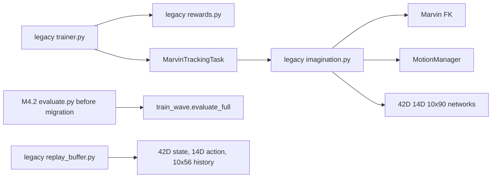
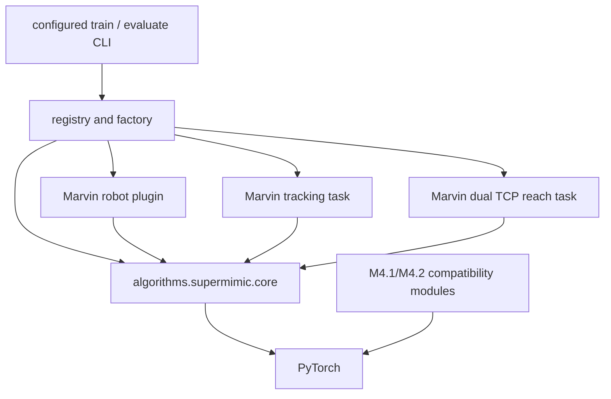

# M4.3 SuperMimic Core architecture

## Baseline and source audit

This design starts at DexGym `55294a5da4de034fed08018956e7a03a15294229`. The 81 M4.2 SuperMimic tests passed before editing. The unchanged M4.1 Wave checkpoint and M4.2 checkpoints are compatibility fixtures.

The paper [SuperMimic, arXiv:2610.28480v1](https://arxiv.org/abs/2610.28480) was read through its equations, Appendix B multi-interface discussion, Algorithm A.1, and Table A.5. TrackerLab source at `e2db2dea0e81c91ebca815c895b60ee9aa58237a` was read in `runner.py`, `networks.py`, `buffer.py` and the tracking MDP; its repository license is MIT. The independent mjlab implementation at `9aab0a588c6941bf9862a2d444b711fd73e2b832` was read in `algo/trainer.py`, `buffer.py`, `state.py`, and `reward.py`; its license is Apache-2.0. No third-party source is copied. Paper equations guide the Core; fixed-base Marvin state and controller semantics remain DexGym adaptations. TrackerLab's masked replay and configurable network dimensions are implementation references, not a claim of official paper authorship. mjlab's state-spec and termination network separation is another implementation reference.

## Current M4.2 dependencies and defects

The old trainer also reads `reference.data["q_arm"]` to normalize Critic input, and the old training script imports Wave-specific supervised PD examples. The Motion Library records FPS without enforcing the environment's 50 Hz frame semantics. The legacy `MotionManager` and Newton environment assume one clip per environment batch. These are migration targets; the original classes and checkpoint weight shapes stay unchanged.

## Dependency rule

No module in `algorithms.supermimic.core` imports `dexgym.tasks`, `dexgym.motion`, the Marvin FK, or Wave scripts. The plugin registry is outside Core. Legacy files retain their existing behavior and strict checkpoint loaders. New components use explicit `RobotSpec`, `TaskSpec`, `TransitionBatch`, and `TaskState` dataclasses with dimensions and schema versions checked at construction.

## Contracts

- `RobotDynamicsAdapter`: `spec`, `integrate(state, delta, action, dynamics_context)`, `physical_delta(state, next_state)`, `executed_command(state, action)`, `physical_state(env)`, action bounds, optional differentiable kinematics, controller timing and asset hash. The Marvin implementation uses 42D `[q14, qd14, qcmd14]`, predicts 28 physical deltas, and applies the versioned analytic 14D command update. A Toy robot uses different dimensions in tests.
- `TaskMDP`: `spec`, `initial_task_state`, `advance`, `goal`, `observation`, `critic_features`, `reward`, `hard_termination`, `soft_termination`, `valid_imagination_start`, `evaluate_metrics`. It may have `motion_id` and `frame` or an independent static `task_data` target. The task owns success and failure metrics. Arrival reward and termination consume `s_(t+1)` with the advanced task state.
- `ReferenceProvider`: current reference, future goals, clip length, FPS and hash; only tracking task uses it. Non-50 Hz references are rejected on import until SO(3)-correct resampling is implemented.
- `PhysicalCollector`: produces a typed, pre-reset `TransitionBatch` from the actual simulator. The batch contains the executed action and command, previous action, state/next-state, dynamics context, task state before/after, hard terminal/truncation, source and failure reason. Replay supplies the environment index from the batch axis.

`TaskState` contains `task_id`, `motion_id`, integer `frame`, and schema-checked floating `task_data`. Motion tracking uses motion ID and frame with zero task-data width. TCP Reach uses a six-number dual-TCP target with no reference timeline. A single trainer instance has one TaskSpec; mixed task batches require a compatible union schema and are deliberately deferred. Replay still records Task ID for provenance and future weighted sampling.

## Generic algorithms

`NetworkFactory` builds a dimension-driven delta world model, goal encoder/Actor, Critic and optional task termination head. It does not alter old `GoalActor`, `DeltaWorldModel` or `PrivilegedCritic` parameter names or shapes. RunningNorm receives only real training-environment states and legal task goals; held-out environment IDs never update statistics. The world model predicts robot-declared physical delta dimensions; the robot integrates analytic state components. Learned termination is separately task-shaped. Analytic termination is the default for Marvin tracking and Reach.

`SchemaReplay` owns the typed ring with absolute timestamps and Episode IDs, masks terminal transitions correctly, and stores configurable state/action/history/context/task-data widths. It never joins a newly reset physical episode to an old one. The `ImaginationEngine` asks the task for observation/goal/reward/termination/critic features and the robot for integration, so it contains no FK, NPZ or link names. It computes `c[t+1]=c[t](1-d[t+1])`, the survival-weighted H-step Actor objective and TD(λ) targets with the same arrival termination index. World model and Critic parameters are frozen during Actor backward; state/action gradients are retained.

`SuperMimicTrainer` alternates physical collection, masked eight-step model fit, actor-source held-out trust evaluation, legal imagination starts, Actor BPTT and Critic fitting. It owns update counts and finite-gradient protection. The configured physical entry point invokes `CoreCheckpoint` and `PhysicalEvaluator` on its bounded schedule. The trainer receives adapters, modules and collector by injection. Teacher dynamics collection is tagged; supervised Actor initialization is a separate optional initializer supplied by the task, never imported from Wave in Core.

`PhysicalEvaluator` orchestrates task-defined metrics after a fresh Newton reset. `InferencePolicy` exports only Actor and inference preprocessing schema, normalizers, robot action version, joint order, control frequency and asset hash; it does not imply real-hardware certification. Old M4.1 and M4.2 checkpoints remain loadable only under their exact original schemas.

## Validation sequence and claims

1. Dimension factory and two Goal Schemas fail-before-fix tests, then generic Replay and world-model math tests.
2. Toy Torch physics with two tasks completes collection, WM8, Actor BPTT and TD(λ) with finite gradients and measured reward improvement.
3. Marvin tracking plugin matches M4.2 Reward, Goal, Action and Actor numerical semantics; the M4.1 Wave full Newton inference regression remains unchanged.
4. Reach plugin uses 1×6 dual-TCP goal, independent reward and success metric, and the same Core trainer in a bounded 16–64 env Newton smoke. This is integration evidence, not convergence.
5. Checkpoint save/restart and CPU/GPU inference parity, then documentation and push.

Gate B requires both 10×90 tracking and 1×6 reach to execute the **same Core trainer code**. Gate E requires real Reach Newton transitions and at least one WM, Actor and Critic update, with actual result metrics. Mixed-motion Newton training and contact-rich dynamics sharing remain explicitly unvalidated unless separately exercised.

## M4.3.1 hardening of the physical boundary

M4.3.1 keeps the M4.3 mathematical Core and adds explicit lifecycle semantics. `MarvinArmNewtonBaseEnv` owns the 54DoF asset, canonical arm joint order, 14D position command, 10 substep interpolation, arm drive profile, hand Home command, contact audit and physical reset writer. `MarvinWaveDirectEnv` and `MarvinReachDirectEnv` are siblings on that base. The base imports no MotionManager or reference path. Reach reads its procedural NPZ only to obtain the previously validated safe **reset pose**; the TCP goal still comes from its own Task MDP. The old Wave class name and legacy evaluator remain callable.

The Newton collector takes `context_t` from `robot.dynamics_context(native_env)` **before** action execution. It checks shape, device, dtype and finite values; Marvin's legitimate context is `[N,0]`. A nonzero context with no adapter method fails. For time-varying context, `RobotSpec.context_evolution="adapter_transition"` requires `next_dynamics_context` in imagination; `episode_constant` is explicit. The Toy tests use different damping contexts for the same state/action and verify Replay, World Model loss and context advancement.

The collector checks each real transition against task and robot contracts: current observation history, executed command, arrival Reward, hard termination and live reference frame. The command check exposed an existing Tensor alias: Newton reset cleared `native.last_action[env_ids]` and thereby mutated the caller's action Tensor on terminal transitions. The base now clones its action before storing it, so Replay keeps the action actually executed. The fixed-seed 20/60-cycle Tracking runs covered the previously failing terminal path.

`PhysicalEvaluator` closes each environment Episode on termination or truncation. It records per-Episode ID, start, return, length, completion, first success/failure, terminal reason, truncation reason, hold duration and task metrics. It distinguishes step success fraction from Episode success rate. The independent-process launcher `scripts/supermimic/evaluate_core_m431.py` loads a v2 Actor with exact semantic checks, uses fresh Newton physics and frozen Actor/normalizers, disables exploration, evaluates one complete Episode per environment and writes a real transition trace. The bounded in-process smoke retains its explicit `inprocess_smoke` label.
