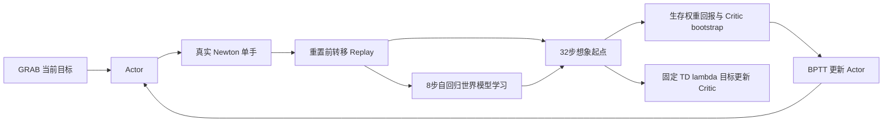

# 单手 S0：任务与 Model-based RL 链路验收

> Historical v1 evidence below includes trust-gated updates. The current standalone
> Hand S0 v2 removes this gate; see the [current checks](hand_s0_no_actor_gate_20261109.md).

## 本阶段结论与范围

本阶段按用户最新要求验证任务定义、训练架构及扩大训练前的工程条件，
**不要求得到收敛或高精度 policy，不继续大规模训练追求精度**。
实现保留原 `right_hand_tracking` 环境，使用官方独立 Wuji Hand 2.1
20 自由度单手；真实采集仍是 Isaac Lab 3.0 / Newton，固定手腕、无物体。
没有使用 Marvin 机械臂模型或旧机械臂权重。

代码具备进一步扩大训练的基础，已验证 256 环境的完整训练循环和
1024 环境、1000 步容量 replay 的短程物理运行。这不等于证明任意规模
均可运行，也不保证策略一定收敛。原有 PPO 后台进程未停止或修改。

## 任务定义和信息边界

GRAB 仍按 s1–s7 训练、s8–s10 验证划分。最短6帧后为942/446段，
281793/122482帧。Actor 仅接收当前指尖目标、手部状态和10帧历史，
没有参考关节角、未来参考帧或教师动作监督。Critic 在训练时使用
参考关节角推导出的目标关键点及任务计数器；这是明确声明的特权输入。

真实环境与想象环境共用子目标推进函数：全部指尖到位、连续保持5–15步后
才能切换；随机跨度、跨轨迹切换、失败预算和完成事件按原任务执行。
控制保持30Hz，物理480Hz；动作经过一次tanh，再执行原有0.1尺度、
0.1死区的关节目标累加。15mm是用户现有成功阈值。

修复/补齐的关键路径：

- 奖励计算使用切换前的目标；控制时钟与参考帧索引分开。
- 真实转移保存自动重置前的状态、目标计数和终止标签。
- 原 PPO 简化 dense 奖励仍保留；S0 增加完整手部关键点 dense 项。
- FK 对照官方 MuJoCo 和实际 Newton USD，另有数值梯度检查。
- 物理测量决定硬阈值标签；微小FK舍入误差不能翻转用于核对的稀疏奖励。
- 修复信任检查中的 NaN 放行和未启用归一化时的异常路径。

TeleDexter 的物体项、真实部署随机化不在本阶段。论文未提供具体手部速度
安全上限，本实现保留原任务的非有限状态/关节范围检查；不声称硬件安全
等价。Wuji 中间关节映射、30Hz转换等选择详见假设台账。

## Model-based RL 路径



动力学状态为 q20、qd20、qcmd20，学习40维物理变化，命令递推解析计算。
执行过的带噪声 latent action 原样进入 replay。世界模型和 Critic 的参数
在 Actor 反传期间冻结，但保留沿预测状态、动作的梯度。Critic 目标在每次
拟合前固定并 detach；终止概率进入生存权重。没有 PPO loss、行为克隆、
q_ref 动作损失或专家 warm start。

离散成功事件使用真实标签训练的概率头，连续几何项解析计算；真实任务
成功判定没有变软。事件头属于世界模型的优化器/冻结/检查点范围。
这是对 TeleDexter 离散任务的适配；事件模型校准和策略利用模型误差的风险
仍需在后续长期训练中监控。
目标切换和dwell计数仍为离散分支，BPTT沿已选分支反传，不代表原混合
系统期望回报的无偏梯度。成功头使用真实到达状态/标签的BCE，区别于
直接拟合自回归标量reward的MSE头；这是任务适配，不能隐去。

## 论文与参考实现核对

主要依据：[TeleDexter 附录C](https://arxiv.org/html/2607.11481v1)，
[SuperMimic 式1–3、算法A.1、表A.5](https://arxiv.org/pdf/2610.28480)。
已对齐 WM8、BPTT32、生存权重、固定 TD(lambda) 目标、Adam学习率2e-4、
Actor betas(.9,.95)、先范数1再逐元素.1裁剪、gamma .99/lambda .95、
Critic 5轮×4 minibatch、动作噪声.1及余弦学习率。

明确的适配：当前目标接口代替未来10帧接口；较小手部网络与批次；
每轮2个256-window世界模型批次和128条想象轨迹；保留 TeleDexter RSI，
没有采用 SuperMimic 人形任务的return-based reset sampling；增加预测质量
门槛后才允许Actor更新；动力学误差按物理delta统计量归一化。
因此这是 **TeleDexter单手任务 + SuperMimic式优化方法**，不是人形实验的
逐参数复刻，也不继承其计算效率或收敛成绩。

另核对了两份独立开源实现的训练循环，未复制源码：

- [TrackerLab runner，e2db2dea](https://github.com/Renforce-Dynamics/trackerlab-supermimic/blob/e2db2dea0e81c91ebca815c895b60ee9aa58237a/source/trackerLab/trackerLab/algorithms/supermimic/runner.py)
- [supermimic-mjlab trainer，9aab0a58](https://github.com/YHFone/supermimic-mjlab/blob/9aab0a588c6941bf9862a2d444b711fd73e2b832/src/supermimic/algo/trainer.py)

## 实测证据

| 检查 | 实际结果 | 能支持的结论 |
|---|---|---|
| 16环境×64步 Newton | 1024转移，30终止，21目标完成；FK最大误差0.000606mm | 原单手模型、采集、奖励/终止对齐 |
| 1024环境×16步，完整1000步replay | 16384转移，181终止，505目标完成；FK最大误差0.005434mm；WM8有限更新 | 扩大环境数和完整replay分配可运行 |
| 256环境训练预跑 | 累计994轮、254464真实转移、1988次WM更新、494次Actor BPTT32更新、9880次Critic更新；非有限更新0次 | 完整训练方法实际执行 |
| 断点恢复 | model_150恢复至下一段，重新采集replay并重新检查模型质量 | 明确的fresh-physics恢复可运行 |
| 全验证集逐帧评估 | 446段、122036个需预测帧全部执行，缺失0帧 | 独立评估路径及覆盖计算可运行 |
| 运行环境 | 持久化依赖路径；executor witness/测试通过，fresh agent原样执行witness和9项测试通过 | 运行命令有独立复核 |

最终回归：262项通过、退出0；35条torch.jit弃用提示。假设复核未发现剩余未声明项（semantic_undeclared=0），不作为独立正确性认可。完整记录在 `implement-stage/BUILD_NOTE.md` 和
`implement-stage/SILENT_ASSUMPTION_SWEEP.json`，原始日志保留在
`/home/ubuntu/dexgym/artifacts/hand_s0/`。

用户收窄范围后主动停止 `hand_s0_pilot_v2`，最后完整日志为994轮。
训练预跑保留的检查点是 `pilot_v2/model_500.pt`；994轮权重未保存，不将它
冒充可加载策略。停止记录为 `pilot_v2/scope_change_stop.json`。

150轮检查点的诊断结果：完整课程单seed子目标成功1320/3287=40.16%，
平均指尖误差25.74mm；逐帧全验证集平均37.98mm、最差指尖P95为101.31mm。
这些数值证明评估可用，**没有达到高精度，不作为本阶段质量通过证据**。
0–5帧离线对齐lag只用于诊断，不能视为不限范围的实际遥操作延迟。

一次早期子目标评估触发了物理/FK阈值奖励核对失败，原日志保留为
`eval_150_subgoals_s101/first_failure.log`。随后将硬事件核对绑定到物理
指尖测量，并保留独立几何一致性检查；边界回归和1024环境短测均通过。

## 扩大训练前的资源边界

1024环境×1000步replay实际分配6,017,040,192字节；短测Torch峰值分配
6,098,866,688字节（不含所有外部物理引擎显存）。256环境配置已运行完整
Actor/Critic循环。1024规模验证是短测，不是长时间稳定性或收敛证明。
当前replay保存完整历史；4096环境的replay单独约24.07GB，因此不能把
“1024短测通过”解读为32GB显卡可直接运行4096全配置。

下一阶段可先沿用已验证的256环境配置增加迭代，或在1024环境下重新确认
完整更新峰值、世界模型跟得上策略变化后扩大。不要同时与原PPO抢占超出
显存容量的配置。本阶段没有启动新的长期训练。

## 可复现命令

工作目录 `/home/ubuntu/dexgym/worktrees/supermimic`，数据路径保持原库。

```bash
# 环境与算法回归
bash scripts/supermimic/hand_s0_host.sh --witness
bash scripts/supermimic/hand_s0_host.sh --pytest -q tests/supermimic

# 仅16控制步的规模/完整replay检查，不是收敛训练
bash scripts/supermimic/hand_s0_host.sh scripts/supermimic/smoke_hand_s0.py \
  --library /home/ubuntu/dexgym/data/processed/hand21_right_geometry_feasible/manifest.json \
  --num-envs 1024 --steps 16 --replay-capacity 1000 \
  --output /home/ubuntu/dexgym/artifacts/hand_s0/manual_scale_check.json

# 后续阶段手动启动；本阶段不执行这个长期命令
bash scripts/supermimic/hand_s0_host.sh scripts/supermimic/train_hand_s0.py \
  --library /home/ubuntu/dexgym/data/processed/hand21_right_geometry_feasible/manifest.json \
  --iterations 50000 \
  --output /home/ubuntu/dexgym/artifacts/hand_s0/next_training
```

学习曲线写入 `iterations.jsonl`；检查点每500轮落盘。扩大时检查
`allowed_horizon`、预测误差、事件校准、实际目标成功率、非有限计数，
不要只看reward。评估入口 `scripts/supermimic/evaluate_hand_s0.py` 支持
`subgoals` 与 `fixed_clock`，只加载Actor，不更新归一化统计。

## 审查边界与假设

首轮fresh reviewer发现Critic特权输入和lag定义未充分声明，均已补齐，
并按用户最新要求更新验收范围。审查通过原生Codex路由请求同家族模型，
但实际身份未由运行时暴露，因此不把请求模型名冒充已验证身份，也不将
正面意见计为跨家族独立认可。完整选择与原始结果见implement-stage。
所有接口/语义假设见下方台账快照及 `ASSUMPTIONS.md`。

## 假设台账快照

# Assumption ledger — Hand S0
ASK=never. Meaning-changing decisions are recorded before dependent code.

| ID | Unspecified detail | Choice | Class | Source |
|---|---|---|---|---|
| A01 | Meaning of S0 | Fixed-wrist, no-object, simulated standalone Hand 2.1 controller; hardware success is not claimed | semantic | user/context |
| A02 | Dataset split | Existing GRAB s1–s7 train, s8–s10 validation; no validation transitions for optimization or normalizers | semantic | default |
| A03 | Current acceptance scope | User explicitly removed converged-policy/high-accuracy acceptance for this phase. Establish task/architecture/algorithm correctness and readiness for later scaling with bounded physical tests and actual updates. Prior 5mm mean/15mm P95/95% success targets are future engineering aspirations, not current pass criteria | semantic | user |
| A04 | Evaluation coverage for this phase | Validate evaluation semantics with at least one held-out seed and the all-clip fixed-clock path. Three seeds and final policy-quality acceptance are deferred to a later authorized training phase; report measured coverage without claiming statistical convergence | semantic | user |
| A05 | Tolerance and reference rate | Keep user's current 15 mm threshold, 30 Hz reference/control, span upper 20→40 over 25600 per-env steps, dwell 5–15, cross probability .1, fail multiplier 1.5 and cross budget300. Paper uses30 mm and quotes60Hz span units; list these adaptations explicitly | semantic | user/context |
| A06 | Reward fidelity | Preserve sparse reached-goal score/time cost; restore paper hand dense terms including thumb/fingers and intermediate knuckles from FK(q_ref), removing only object terms. Existing PPO simplified-dense reward remains a labelled historical baseline; algorithm comparison uses matched task settings | semantic | default |
| A07 | Actor and Critic information | Actor receives causal current fingertip target and deployable hand state/history, never q_ref or future reference. Critic receives privileged counters/budgets and q_ref-derived target fingertip/intermediate-knuckle geometry for training bootstrap. q_ref also supplies RSI, reward geometry and privileged diagnostics, never an Actor action target or teacher-action loss | interface | sweep |
| A08 | Core reuse | Extend current Core with state-dependent task transitions; preserve legacy task advance behavior. Separate control clock from reference index; cross-motion target changes do not mean physical reset | interface | default |
| A09 | Discontinuous task gradients | Real task events remain exact. Use model-based differentiable reward/termination heads fitted to true transition labels where hard threshold/dwell prevents pathwise gradients. Any learned approximation is evaluated against true rewards/events; no straight-through fake gradients or teacher action loss | semantic | default |
| A10 | Physical model | Existing official standalone USD, SI drives, implicitfast480Hz/30Hz, full collisions. Learned state initially [q20,qd20,qcmd20]; known command update analytic. Do not reuse arm-model weights | interface | user |
| A11 | Final robustness scope | Primary S0 accuracy benchmark uses nominal dynamics and fixed wrist, matching existing PPO. Paper action masking/randomization and deployment differences must be audited and explicitly separated from nominal algorithm evidence | semantic | default |
| A12 | Existing GPU job | Keep current PPO running during CPU development. Do not launch a large competing GPU job without resource planning; preserve its saved checkpoints/logs if later scheduling requires a change | interface | default |
| A13 | Artifacts and publishing | Keep data/replay/large checkpoints outside Git; commit reproducible code/configs/reports and store selected policy through existing LFS conventions. Push only new supermimic branch | interface | user |
| A14 | Hand intermediate knuckle geometry | lvl1 uses each official proximal body origin, lvl2 the middle body origin, all relative to r_wrist. Sites come from the official MJCF, checked against Newton USD; this is the explicit Wuji embodiment mapping of the paper knuckle reward | semantic | default |
| A15 | Model action coordinates | Core Actor emits latent action; apply tanh exactly once before the unchanged PPO deadzone/command map. Replay stores latent executed sample including exploration noise; Actor history stores bounded executed action. This preserves the same physical action support as PPO | interface | default |
| A16 | Dense knuckle aggregation | Apply each lvl1/lvl2 exponential kernel to the mean Euclidean knuckle error over five fingers, weighted .6/.4; appendix says knuckles are averaged across fingers but does not supply source code. Report this interpretation explicitly | semantic | default |
| A17 | Reward event model | Fit a small reach-probability head on real transitions, with exact pre-goal counters and arrival fingertip errors. Use analytic dense and sparse score multiplied by predicted reach probability during imagination; physical rewards/events remain exact. Head is owned/frozen/checkpointed with world model; no label reweighting so probabilities retain event calibration | interface | default |
| A18 | Training scale and trust | Bounded pilot uses 256 real Newton environments, 1000-step replay, smaller hand networks, WM8 and Actor BPTT32 only. Actor starts after 200 world updates and held-out-lane 1/8/32 predictions beat zero-delta baseline with mean tip error <=1.5/4/7.5 mm. Separate lanes use training subjects; GRAB validation is evaluation-only. This added engineering gate is not a paper claim. Stop convergence training under the user's scope update | semantic | user/default |
| A19 | Optimizer and resume | Actor Adam betas(.9,.95), global gradient norm clip1 followed by value clip.1; world/Actor/Critic initial lr2e-4; gamma.99 lambda.95; Critic5epochs4minibatches. Cosine LR floor.03 at250000iterations. Intermediate saves use explicit fresh-physics resume, preserve model/optimizer/normalizers and curriculum counter but recollect replay | interface | default |
| A20 | Fixed-clock evaluation | Separate diagnostic: initialize each clip at q_ref[0], then advance tip target one frame per30Hz step regardless of error; terminate only on unsafe state or clip end. Retain pre-failure errors and report missing frames/failed clips. Delay diagnostic minimizes per-clip overlapping-frame error over integer lags0–5, then reports median lag across clips; it is not unrestricted latency, and primary errors are uncompensated. Subgoal success uses unchanged full curriculum | semantic | sweep |
| A21 | Reset sampling priority | Use the existing TeleDexter-style uniform motion RSI in each clip's first90%, not SuperMimic's return-based reference sampling. The adapted task defines reset distribution; WM8/BPTT32/survival/TD(lambda) define the model-based optimizer | semantic | default |
| A22 | Safety termination scope | Preserve original hand task's nonfinite-state and joint-range guards plus goal failure/completion/time limits. TeleDexter lists velocity safety bounds without publishing numeric hand bounds; this nominal S0 does not invent a hardware velocity limit and does not claim hardware safety equivalence | semantic | default |
| A23 | Hybrid-gradient interpretation | Goal switches/dwell counters remain exact discrete branches in imagination; BPTT differentiates the realized branch and learned reward/termination surrogate. It is not an unbiased gradient of the original hybrid simulator's expected return. Reach head uses unweighted BCE on real arrival states/labels, rather than a direct autoregressive scalar-reward MSE head. These are explicit single-hand task adaptations | semantic | sweep (executor source audit) |

## Interpretation notes
A03 supersedes the original policy-precision completion gate by explicit user
request, not because an experiment missed that gate. Current measured policy
errors remain reported without presenting the pilot as a converged controller.
A09 is required by the actual hybrid task, not an excuse to replace it with
fixed-time motion imitation. Exact physical event labels remain authoritative.

## 复核后恢复顺序修正
恢复时先还原课程计数，再重新建立采集器并采样初始目标，避免从较晚课程断点恢复时第一批目标仍按初始课程采样。此launcher顺序修正由执行者在resume_validation中以2轮恢复检查验证，未再进行第三轮外部假设审查。该检查不用于策略质量结论。

机器可读的实测汇总：[hand_s0_validation_20261109.json](../experiments/hand_s0_validation_20261109.json)。
